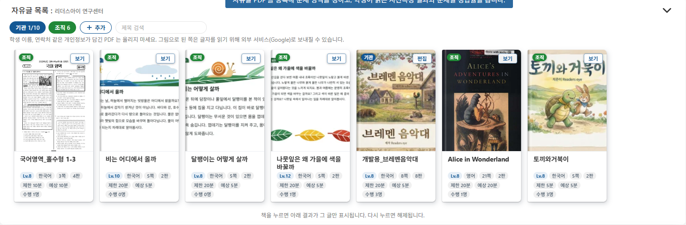
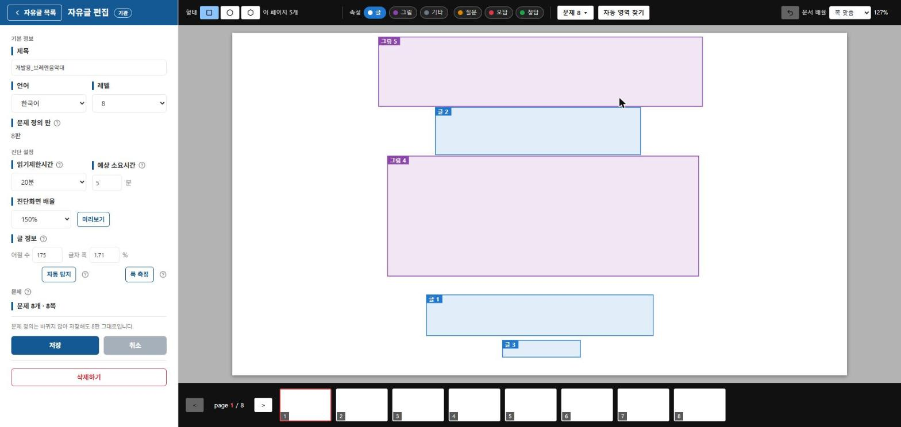

# 자유글 문서 등록하기

\[기관] 노드를 선택하고, \[자유글2] 탭을 엽니다. 이 탭의 \[자유글 목록] 박스에서 시선측정에 쓸 PDF 문서를 등록하고 편집합니다.


자유글 문서는 관리자만 등록, 수정, 삭제할 수 있습니다. 등록할 수 있는 문서 수는 플랜에 따라 다릅니다.



학생 이름, 연락처 같은 개인정보가 담긴 PDF는 올리지 마세요. 그림으로 된 쪽은 글자를 읽기 위해 외부 서비스(Google)로 보내질 수 있습니다.


## 문서 목록 보기

<figure><figcaption></figcaption></figure>

등록된 문서는 책 카드 형태로 표시됩니다.

* \[기관] \[조직] 버튼으로 기관이 만든 문서와 소속 조직이 만든 문서를 나누어 볼 수 있습니다. 버튼에는 현재 등록 수가 함께 표시됩니다. (예: `기관 1/10`, `조직 6`)
* 제목 검색 칸에서 문서를 찾을 수 있습니다.
* 카드 왼쪽 위에는 만든 주체(기관 또는 조직)가 표시됩니다.
* 기관 문서 카드에는 \[편집] 버튼이, 조직 문서 카드에는 \[보기] 버튼이 있습니다. 조직 문서는 읽기 전용이므로 수정하거나 삭제할 수 없습니다.
* 카드 아래 칩으로 레벨, 언어, 쪽 수, 문제 정의 판, 읽기 제한 시간, 예상 소요 시간, 수행 인원을 확인할 수 있습니다.
* 기관 문서가 등록 상한에 이르면 \[＋ 추가] 버튼이 흐리게 표시되며 더 이상 등록할 수 없습니다.
* 책을 누르면 아래 \[자유글2 측정 결과] 박스에 그 글의 결과만 표시됩니다. 다시 누르면 해제됩니다.

## 새 문서 등록하기

1. \[＋ 추가] 버튼을 누릅니다.
2. PDF 파일 선택 창에서 등록할 파일을 고릅니다.
3. \[자유글 편집] 화면이 열리며, 문서 제목이 파일 이름으로 자동 입력됩니다.
4. 아래 내용을 확인하고 필요한 항목을 고친 뒤 \[저장]을 누릅니다.


PDF 파일만 등록할 수 있으며, **최대 25쪽**까지 가능합니다. 26쪽 이상인 문서는 등록되지 않습니다.


## 편집 화면 구성

<figure><figcaption></figcaption></figure>

왼쪽에는 문서 정보를 입력하는 패널이, 가운데에는 문서와 영역이 표시됩니다. 맨 아래에는 쪽 이동 버튼과 쪽 목록이 있습니다. 항목 이름 옆의 \[?] 아이콘에 마우스를 올리면 설명이 표시됩니다.

### 기본 정보

| 항목 | 설명 |
|---|---|
| 제목 | 최대 60자까지 입력할 수 있습니다. |
| 언어 | 문서의 언어를 선택합니다. |
| 레벨 | 문서에 맞는 **적정 연령**을 5부터 19까지 나이별로 고르고, 20세 이상은 \[20 이상]으로 고릅니다. |
| 문제 정의 판 | 문서의 영역과 문제 정의가 바뀌어 저장될 때 새로 매겨지는 판 번호입니다. 직접 고치는 값이 아닙니다. 정의가 바뀌지 않았다면 저장해도 판은 그대로입니다. |

### 진단 설정

| 항목 | 설명 |
|---|---|
| 읽기제한시간 | 학생이 문서를 읽을 수 있는 최대 시간입니다. 5분, 10분, 15분, 20분, 30분, 40분, 제한 없음 중에서 고릅니다. 시간이 끝나면 측정이 자동으로 종료되고 저장됩니다. |
| 예상 소요시간 | 학생이 문서를 읽는 데 걸릴 것으로 예상되는 시간(분)입니다. 새 문서의 기본값은 5분입니다. |
| 진단화면 배율 | 학생에게 보이는 문서의 크기입니다. \[미리보기] 버튼으로 학생 화면에서 어떻게 보일지 확인할 수 있습니다. |

### 글 정보

읽기 속도와 도약폭을 계산하려면 문서의 글 분량과 글자 크기를 알아야 합니다. 다음 두 값을 입력합니다.

* **어절 수**: 문서 전체의 어절 수입니다. 영어 문서는 단어 수를 입력합니다.
* **글자 폭**: 글자 하나가 쪽 가로폭에서 차지하는 비율(%)입니다.

두 값은 직접 입력하지 않고 다음 버튼으로 구할 수도 있습니다.

* **\[자동 탐지]**: PDF에 들어 있는 글자 정보를 읽어 어절 수와 글자 폭을 자동으로 채웁니다.
* **\[폭 측정]**: 문서 위에서 글자 몇 개를 마우스로 드래그하면 글자 폭을 측정해 줍니다.


이 두 값은 읽기 속도와 도약폭 계산에 쓰이므로, 자동으로 채워진 값이 문서와 맞는지 확인해 주세요.


## 영역 설정하기

문서 위에 **영역**을 그려서 시선이 어디에 머물렀는지 분석할 수 있도록 합니다. 화면 위쪽의 도구 바를 사용합니다.

### 영역 모양과 속성

* **형태**: 사각형, 원, 다각형 중에서 영역 모양을 고릅니다.
* **속성**: 영역마다 다음 여섯 가지 중 하나를 지정합니다.

| 속성 | 용도 |
|---|---|
| 글 | 읽어야 할 본문 |
| 그림 | 그림, 도표, 지도 등 |
| 기타 | 위 어디에도 속하지 않는 부분 |
| 질문 | 문제의 질문 |
| 오답 | 문제의 틀린 보기 |
| 정답 | 문제의 맞는 보기 |

### 영역 만들기

* 모양과 속성을 고른 뒤 문서 위에 영역을 그립니다.
* **\[자동 영역 찾기]** 버튼을 누르면 문서에서 영역을 자동으로 찾아 줍니다. 결과는 반드시 확인하고 필요하면 고쳐 주세요.
* 글 영역의 \[⋯] 메뉴에서 영역별 어절 수를 확인할 수 있고, \[다시 세기]로 다시 계산할 수 있습니다.
* \[문서 배율]에서 편집 화면에 보이는 문서의 크기를 바꿀 수 있습니다. 학생 화면의 배율과는 별개입니다.

### 문제로 묶기

시험 문제처럼 질문과 보기가 있는 문서는 관련 영역을 묶어 하나의 **문제**로 만들 수 있습니다.

* 문제 유형은 선다형과 복수 선택을 지원합니다.
* 질문, 정답, 오답 영역을 지정해 두면 결과 보고서에서 정답률과 문제풀이 시간을 확인할 수 있습니다.
* 영역을 여러 개 선택하면 상황에 맞는 \[문제로 묶기], \[문제 해제], \[삭제] 버튼이 나타납니다.
* 문서에 묶인 문제 수와 쪽 수는 왼쪽 패널의 \[문제] 항목에 표시됩니다.

## 저장하기

편집을 마치면 \[저장]을 누릅니다. 저장한 시점 이후에 시작하는 측정부터 수정한 내용이 적용됩니다. 저장하지 않고 나가려면 \[취소]를 누릅니다.

## 문서 삭제하기

편집 화면 맨 아래의 \[삭제하기] 버튼으로 문서를 삭제합니다. 삭제하면 학생이 더 이상 측정할 수 없습니다. 이미 수행한 기록은 결과 목록에 남으며, 제목 옆에 **삭제된 글**이라고 표시됩니다.


삭제된 문서의 결과는 \[재분석]을 할 수 없습니다.

