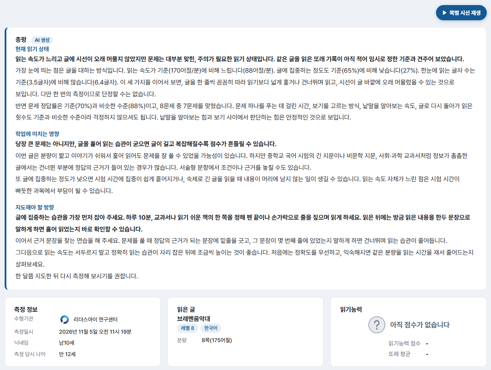
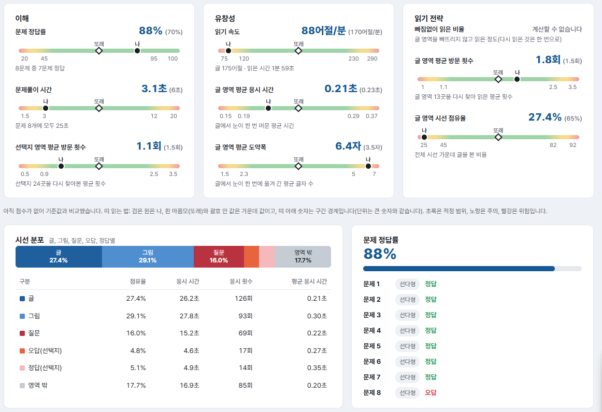
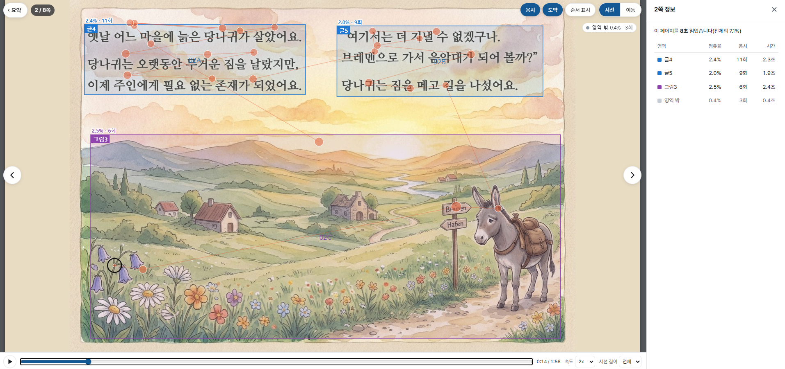
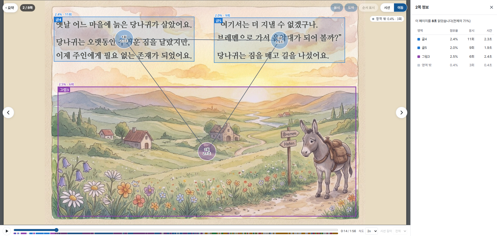
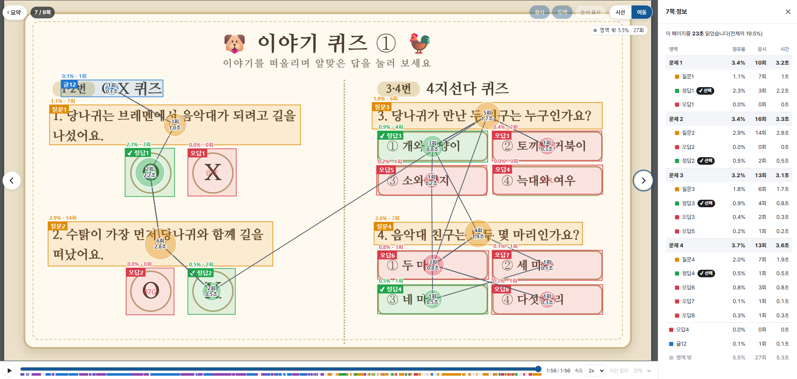

# 자유글 시선측정 결과 보기

학생이 자유글 측정을 마치면 \[자유글2] 탭의 \[자유글2 측정 결과] 박스에 결과가 쌓입니다. 결과 목록에서 측정 결과를 열고, 결과 보고서와 시선 재생 화면을 볼 수 있습니다.

## 측정 결과 목록 보기

1. \[기관] 노드를 선택하고 \[자유글2] 탭을 엽니다.
2. \[자유글2 측정 결과] 박스에서 결과 목록을 확인합니다.

목록에는 닉네임, 학생ID, 측정 당시 나이, 수행일시, 자유글, 판, 언어, 읽기능력 점수, 정답률이 표시됩니다.

* 위쪽 선택 칸에서 특정 자유글의 결과만 모아 볼 수 있습니다. 위 \[자유글 목록] 박스에서 책 카드를 눌러도 같은 효과가 있습니다.
* 학생 이름과 제목으로 검색하거나, 칸별 검색 칸으로 조건을 좁힐 수 있습니다.
* 열 제목을 눌러 정렬하고, \[컬럼]으로 보고 싶은 열만 고를 수 있습니다.
* \[다운로드]로 목록을 내려받을 수 있습니다.
* 같은 문서를 읽은 또래 기록이 적으면 읽기능력 점수는 \[-]로 표시됩니다.


자유글 문서를 삭제해도 수행 기록은 목록에 남고, 제목 옆에 **삭제된 글**이라고 표시됩니다.


## 측정 결과 창

목록에서 원하는 행을 누르면 측정 결과 창이 열립니다.

| 항목 | 설명 |
|---|---|
| 보고서 링크 | 결과 보고서의 주소입니다. \[복사]로 복사할 수 있습니다. |
| \[내 결과 열기] | 보고서를 새 탭으로 엽니다. |
| \[이메일로 보내기], \[SMS로 보내기] | 학부모나 교사에게 보고서 링크를 보냅니다. |
| \[재분석] | 문서를 고친 뒤, 최신 판으로 지표, 점수, 총평을 다시 만듭니다. |
| 개인정보 표시 | 기본적으로 체크되어 있습니다. 체크를 풀면 닉네임, 학생ID, 소속, 수행기관을 가린 채 보고서가 열립니다. |


\[재분석]을 하면 이전 분석 값이 새 값으로 **덮어써지며 되돌릴 수 없습니다.** 확인 창이 뜨면 내용을 확인한 뒤 진행하세요. 삭제된 문서의 결과는 재분석할 수 없습니다.


## 결과 보고서 보기

보고서는 링크로 열리며, 요약 화면과 쪽 화면으로 구성됩니다. 학부모와 교사에게 그대로 보낼 수 있도록 구성되어 있습니다.

### 요약 화면

<figure><figcaption></figcaption></figure>

**총평**

맨 위에 \[AI 생성] 표시가 붙은 총평 카드가 있습니다. 다음 세 가지 소제목으로 나뉩니다.

* **현재 읽기 상태**: 학생이 문서를 어떻게 읽었는지 쉬운 말로 정리합니다.
* **학업에 미치는 영향**: 이 읽기 방식이 학업에 줄 수 있는 영향을 설명합니다.
* **지도해야 할 방향**: 가정과 학교에서 해 볼 수 있는 지도 방법을 제안합니다.


총평은 한 번의 측정을 바탕으로 한 AI의 해석이므로 진단명이나 원인을 단정하지 않습니다. 총평을 만드는 중이거나 유효하지 않은 측정이면 카드가 표시되지 않습니다.


**정보 카드**

* **측정 정보**: 수행기관, 측정일시, 닉네임, 측정 당시 나이를 보여 줍니다.
* **읽은 글**: 문서의 썸네일과 제목, 레벨, 언어, 분량을 보여 줍니다.
* **읽기능력**: 읽기능력 등급과 점수, 또래 평균을 보여 줍니다.

### 읽기능력 점수와 등급

* 점수는 **0~99점**이며, 같은 문서를 읽은 또래(측정 당시 나이 ±1세)와 견주어 정해집니다.
* 등급은 **우수, 양호, 주의, 미흡**으로 표시됩니다.
* 점수에는 이해, 유창성, 읽기 전략 세 영역이 모두 반영됩니다.


같은 문서를 읽은 또래 기록이 **20명 미만**이면 점수와 등급을 내지 않고 \[아직 점수가 없습니다]로 표시합니다. 이때 지표는 또래 대신 연령과 언어별 임시 기준과 비교하며 그 안내 문구가 함께 표시됩니다. 한 번 정해진 점수는 바뀌지 않고, \[재분석]을 눌러야 다시 정해집니다.


### 지표 카드

<figure><figcaption></figcaption></figure>

읽기 상태를 세 영역으로 나누어 지표별로 보여 줍니다.

| 영역 | 지표 | 설명 |
|---|---|---|
| 이해 | 문제 정답률 | 맞힌 문제의 비율입니다. |
| | 문제풀이 시간 | 문제 하나를 푸는 데 걸린 평균 시간입니다. |
| | 선택지 영역 평균 방문 횟수 | 보기 영역을 다시 찾아본 평균 횟수입니다. |
| 유창성 | 읽기 속도 | 1분에 읽은 어절 수입니다. |
| | 글 영역 평균 응시 시간 | 글에서 눈이 한 번 머문 평균 시간입니다. |
| | 글 영역 평균 도약폭 | 글에서 눈이 한 번에 옮겨 간 평균 글자 수입니다. |
| 읽기 전략 | 빠짐없이 읽은 비율 | 글 영역을 빠뜨리지 않고 읽은 정도입니다. 다시 읽은 것은 한 번으로 셉니다. 계산할 수 없는 경우 \[계산할 수 없습니다]로 표시됩니다. |
| | 글 영역 평균 방문 횟수 | 글 영역을 다시 찾아 읽은 평균 횟수입니다. |
| | 글 영역 시선 점유율 | 전체 시선 가운데 글을 본 비율입니다. |

**지표 읽는 법**

* 지표 한 줄에는 지표 이름, **내 값**, 괄호 안의 **또래 값**, 그리고 적정 범위 띠가 있습니다.
* 띠의 **검은 원**은 학생(나), **흰 마름모**는 또래의 가운데 값입니다.
* 띠 아래 숫자는 구간의 경계입니다.
* 색은 **초록이 적정 범위, 노랑이 주의, 빨강이 위험**입니다. 문제 정답률처럼 낮은 쪽만 위험한 지표도 있습니다.

### 시선 분포와 문제 정답률

* **시선 분포**: 학생의 시선이 글, 그림, 기타, 질문, 오답, 정답, 영역 밖 중 어디에 얼마나 머물렀는지 막대와 표로 보여 줍니다. 표에는 점유율, 응시 시간, 응시 횟수, 평균 응시 시간이 나옵니다.
* **문제 정답률**: 전체 정답률과 문제별 정답, 오답 여부, 문제 형태가 표시됩니다.

## 쪽 화면 보기

요약 화면 오른쪽 위의 **\[쪽별 시선 재생]** 버튼을 누르면 쪽 화면이 열립니다. 학생이 문서를 읽은 과정을 영상처럼 재생해서 볼 수 있습니다.

<figure><figcaption></figcaption></figure>

### 쪽 이동하기

* 화면 좌우의 \[‹] \[›] 버튼으로 쪽을 이동합니다. 키보드의 좌우 방향키도 사용할 수 있습니다.
* 왼쪽 위에는 요약 화면으로 돌아가는 \[‹ 요약] 버튼과 현재 쪽(예: 2 / 8쪽)이 표시됩니다.

### 재생하기

* 아래 컨트롤러의 \[▶] 버튼으로 재생합니다. 진행바 옆에는 현재 시간과 전체 시간이 표시되며, 진행바를 눌러 원하는 시점으로 이동할 수 있습니다.
* 학생이 측정 중에 쪽을 오간 순서(다시 돌아온 것 포함)가 그대로 하나의 시간 흐름으로 이어져 재생됩니다.
* **속도**: 재생 속도를 정합니다. 기본값은 2x입니다.
* **시선 길이**: 시선 자취가 남는 시간을 정합니다. 기본값은 \[전체]이며, 짧을수록 자취가 적게 남습니다.

### 시선 보기와 이동 보기

화면 오른쪽 위의 \[시선] \[이동] 버튼으로 보기 방식을 바꿉니다.

**시선 보기**

학생의 응시와 도약을 그대로 보여 줍니다. 원은 눈이 머문 곳이고 원의 크기는 머문 시간을 나타냅니다. 원 사이의 선은 눈이 옮겨 간 도약입니다.

* \[응시], \[도약], \[순서 표시] 버튼으로 표시할 요소를 켜고 끌 수 있습니다.

**이동 보기**

<figure><figcaption></figcaption></figure>

같은 영역에 연속해서 머문 것을 **방문 1회**로 묶어, 영역 사이의 이동만 보여 줍니다.

* 영역마다 원이 표시되고, 원 안에 방문 횟수와 누적 시간(예: 1회, 2.3초)이 나옵니다. 오래 머문 영역일수록 원이 큽니다.
* 영역 사이를 오간 순서가 선으로 이어집니다.
* 이동 보기에서는 \[응시], \[도약], \[순서 표시]와 \[시선 길이]를 쓸 수 없습니다.

### 영역 정보 패널

오른쪽의 \[n쪽 정보] 패널에서 그 쪽의 읽은 시간과, 영역별 점유율, 응시 횟수, 시간을 확인할 수 있습니다.

* 영역 이름은 속성과 번호(글1, 질문1, 오답1, 정답1 등)로 표시됩니다.
* 같은 문제로 묶인 영역은 나란히 표시되고, 맨 윗줄에 문제 전체의 합계가 나옵니다.
* 오른쪽 위 \[✕]로 패널을 접고, 다시 열 수 있습니다.

### 문제의 정답과 선택 표시

<figure><figcaption></figcaption></figure>

문제가 있는 쪽에서는 영역을 색으로 구분합니다.

| 영역 | 색 |
|---|---|
| 질문 | 주황 |
| 오답 | 빨강 |
| 정답 | 초록 |

학생이 고른 보기에는 **\[✔ 선택]** 표시가 붙고 외곽선이 굵게 표시됩니다. 맞혔으면 초록, 틀렸으면 빨강으로 보입니다.


학생이 어느 보기를 골랐는지는 클릭 기록을 바탕으로 추정한 것입니다. 클릭 기록이 없는 문제에는 선택 표시가 나타나지 않습니다.


### 휴대폰에서 보기

휴대폰에서는 화면을 가로로 돌려 봅니다. 버튼은 화면을 한 번 누르면 나타나고 3초 뒤에 사라집니다. 정보 패널은 닫힌 채로 시작하며, 열면 전체 화면으로 표시됩니다.
