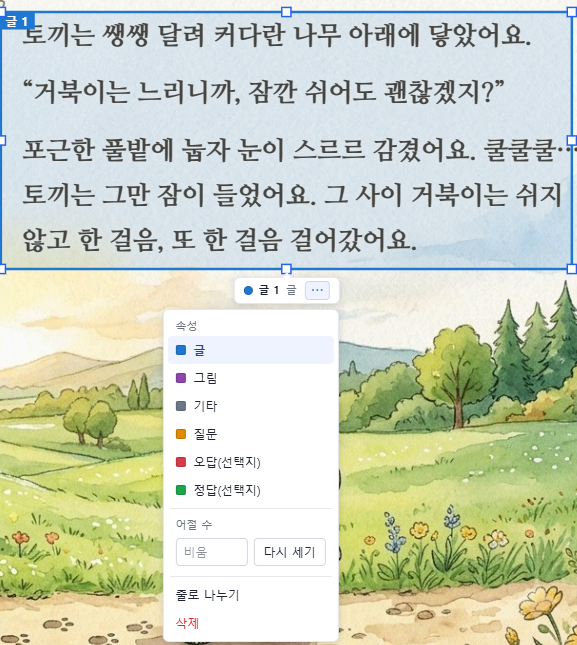
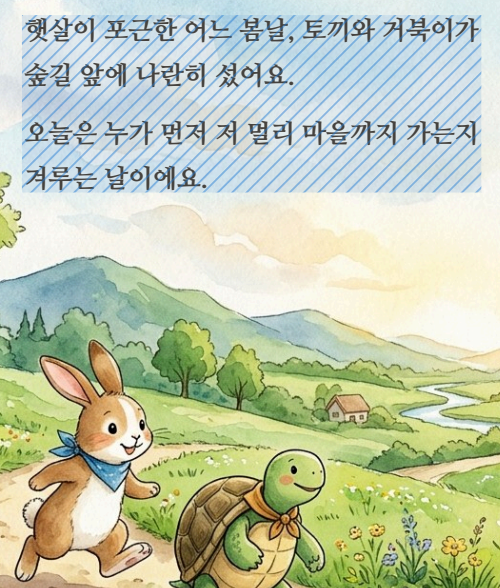

# 자유글 영역 설정하기

자유글 문서 위에 **영역**을 설정하면, 학생의 시선이 문서의 어느 부분(글, 그림, 질문, 보기 등)에 얼마나 머물렀는지 분석할 수 있습니다. 영역은 \[자유글 편집] 화면에서 설정합니다. 편집 화면을 여는 방법은 [자유글 문서 등록하기](new_free_pdf.md)를 참고하세요.


영역을 설정하지 않아도 측정은 할 수 있지만, 영역별 분석과 읽기 속도, 문제 정답률 같은 지표는 영역이 있어야 계산됩니다. 글 영역은 꼭 지정해 주세요.


## 영역 속성

영역마다 다음 여섯 가지 속성 중 하나를 지정합니다.

| 속성 | 용도 |
|---|---|
| 글 | 읽어야 할 본문 |
| 그림 | 그림, 도표, 지도 등 |
| 기타 | 위 어디에도 속하지 않는 부분 |
| 질문 | 문제의 질문 |
| 오답(선택지) | 문제의 틀린 보기 |
| 정답(선택지) | 문제의 맞는 보기 |

## 영역 만들기

편집 화면 위쪽의 영역 도구 바를 사용합니다.

<figure><figcaption></figcaption></figure>

| 도구 | 설명 |
|---|---|
| 형태 | 영역의 모양을 **사각형, 원, 다각형** 중에서 고릅니다. 오른쪽에 현재 쪽에 만들어진 영역의 수(예: 이 페이지 1개)가 표시됩니다. |
| 속성 | 새로 만들 영역의 속성을 고릅니다. |
| 문제 | 영역을 묶어 만든 문제의 목록입니다. |
| \[자동 영역 찾기] | 글 영역을 자동으로 찾아 줍니다. |

### 직접 만들기

1. 쪽 목록에서 영역을 만들 쪽을 선택합니다.
2. \[형태]에서 모양을, \[속성]에서 속성을 고릅니다.
3. 문서 위에 영역을 그립니다. 다각형은 \[다각형] 버튼에 마우스를 올리면 그리는 방법이 안내됩니다.
4. 영역이 만들어지면 이름이 속성과 번호(글1, 그림2 등)로 자동 지정됩니다.

영역을 선택하면 가장자리에 점이 나타나며, 점을 끌어 크기를 바꾸고 영역을 끌어 위치를 옮길 수 있습니다.

## 영역 설정 메뉴

영역을 선택하면 영역 위쪽에 이름과 속성, \[⋯] 버튼이 나타납니다. \[⋯]을 누르면 설정 메뉴가 열립니다.

<figure><figcaption></figcaption></figure>

| 메뉴 | 설명 |
|---|---|
| 속성 | 영역의 속성을 바꿉니다. |
| 어절 수 | 글 영역에 들어 있는 어절 수를 보여 줍니다. \[다시 세기]를 누르면 영역 안의 글자를 다시 읽어 어절 수를 새로 셉니다. |
| 줄로 나누기 | 영역을 줄 단위의 영역으로 나눕니다. |
| 삭제 | 영역을 지웁니다. |


어절 수는 글 영역에서만 쓰입니다. 영역을 옮기거나 크기를 바꿨다면 \[다시 세기]로 어절 수를 맞춰 주세요.


## 글 영역 자동으로 찾기

글이 많은 문서는 \[자동 영역 찾기]로 글 영역을 한꺼번에 만들 수 있습니다.

1. 영역 도구 바의 \[자동 영역 찾기]를 누릅니다.
2. 문서에서 찾은 글 영역 **후보**가 사선 무늬의 파란색 영역으로 표시됩니다.

<figure><figcaption></figcaption></figure>

3. 화면 아래에 결과 안내가 나타납니다. 안내에는 이 쪽의 후보 수와 어절 수, 문서 전체의 후보 수가 표시됩니다.

<figure><figcaption></figcaption></figure>

4. 후보를 어떻게 만들지 고릅니다.
   * **후보를 눌러** 원하는 후보만 하나씩 영역으로 만듭니다.
   * **\[모두 만들기]**를 눌러 모든 후보를 한 번에 영역으로 만듭니다.
   * **\[그만두기]**를 눌러 후보를 버리고 돌아갑니다.


자동으로 찾은 영역은 정확하지 않을 수 있습니다. 만든 뒤에는 쪽마다 영역이 글의 범위에 맞는지, 그림이나 질문이 글 영역에 섞이지 않았는지 확인하고, 필요하면 크기와 속성을 고치세요.



그림으로 된 글은 이미지에서 글자를 읽는 과정에서 외부 서비스(Google)로 보내질 수 있습니다. 개인정보가 담긴 문서는 올리지 마세요.


## 문제로 묶기

질문과 보기가 있는 문서는 영역을 묶어 **문제**로 만들 수 있습니다. 자세한 방법은 [자유글 문제 설정하기](set_quiz.md)를 참고하세요.

## 저장하기

영역 설정을 마치면 편집 화면 왼쪽 아래의 \[저장]을 누릅니다. 저장하지 않으면 영역이 반영되지 않으며, 저장한 시점 이후에 시작하는 측정부터 새 영역이 적용됩니다.
