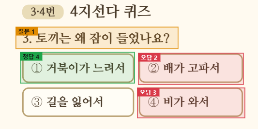
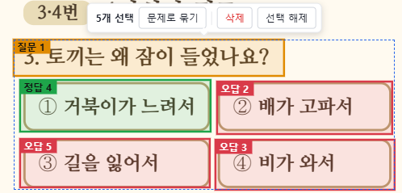
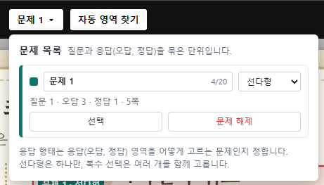

# 자유글 문제 설정하기

기출시험문제지나 퀴즈가 들어 있는 문서는 질문과 보기를 묶어 **문제**로 설정할 수 있습니다. 문제를 설정하면 다음과 같은 효과가 있습니다.

* 학생이 진단 중에 보기 영역을 **마우스로 눌러 답을 고를 수 있습니다.**
* 결과 보고서에서 문제 정답률, 문제풀이 시간, 학생이 고른 보기를 확인할 수 있습니다.

문제는 \[자유글 편집] 화면에서 설정합니다. 먼저 [영역 설정하기](set_aoi.md)로 영역을 만드는 방법을 익혀 두세요.

## 문제의 구성

문제 하나는 다음 영역을 묶은 것입니다.

| 영역 | 설명 | 개수 |
|---|---|---|
| 질문 | 문제의 질문 | 1개 |
| 정답(선택지) | 맞는 보기 | 1개 이상 |
| 오답(선택지) | 틀린 보기 | 1개 이상 |

정답과 오답 영역을 합쳐 **응답 영역**이라고 부릅니다. 학생은 진단 중에 응답 영역을 눌러 답을 고릅니다.

## 문제 설정 순서

### 1. 질문, 정답, 오답 영역 만들기

문제로 만들 부분에 영역을 각각 만들고 속성을 지정합니다. 영역 만드는 방법은 [자유글 영역 설정하기](set_aoi.md)를 참고하세요.

* 질문 문장에는 **질문** 속성을 지정합니다.
* 맞는 보기에는 **정답(선택지)**, 틀린 보기에는 **오답(선택지)** 속성을 지정합니다.
* 영역마다 속성과 번호가 이름으로 표시됩니다. (예: 질문1, 정답4, 오답2)

<figure><figcaption></figcaption></figure>

위 그림은 질문 1개와 정답 1개, 오답 2개를 만든 모습입니다. 질문은 주황, 정답은 초록, 오답은 빨강으로 구분됩니다. 아직 영역을 만들지 않은 ③번 보기는 색이 없습니다. 문제로 묶기 전에 모든 보기에 영역과 속성을 지정해 주세요.

### 2. 영역 묶어 문제 만들기

1. 문제에 속하는 영역(질문, 정답, 오답)을 모두 선택합니다.
2. 선택한 영역 위에 선택 막대가 나타납니다. 선택한 영역 개수와 함께 \[문제로 묶기], \[삭제], \[선택 해제] 버튼이 표시됩니다.
3. \[문제로 묶기]를 누릅니다.

<figure><figcaption></figcaption></figure>


\[삭제]를 누르면 선택한 영역이 모두 지워집니다. 묶기를 취소하려면 \[선택 해제]를 누르세요.


### 3. 문제 목록에서 확인하고 설정하기

문제를 만들면 화면 위쪽 영역 도구 바의 \[문제] 드롭다운에서 문제 목록을 볼 수 있습니다.

<figure><figcaption></figcaption></figure>

| 항목 | 설명 |
|---|---|
| 문제 이름 | 문제의 이름입니다. 최대 20자까지 고칠 수 있습니다. |
| 문제 유형 | 응답 방식을 **선다형** 또는 **복수 선택**으로 정합니다. |
| 구성 | 문제에 묶인 영역의 수(질문, 오답, 정답)와 문제가 있는 쪽이 표시됩니다. |
| \[선택] | 문제에 묶인 영역을 한 번에 선택해 위치와 속성을 확인합니다. |
| \[문제 해제] | 묶음을 풉니다. 영역은 그대로 남습니다. |

### 문제 유형 정하기

문제 유형은 학생이 응답 영역을 어떻게 고르는지를 정합니다.

| 유형 | 응답 방식 |
|---|---|
| 선다형 | 보기를 **하나만** 고를 수 있습니다. 다른 보기를 누르면 선택이 바뀝니다. |
| 복수 선택 | 보기를 **여러 개** 함께 고를 수 있습니다. |


복수 선택 문제는 정답 영역을 여러 개 만들어 설정합니다.


## 문제 수정하기

* **영역을 고치려면** 영역을 선택해 크기와 속성을 바꿉니다. 묶인 문제는 유지됩니다.
* **묶음을 풀려면** 문제 목록에서 \[문제 해제]를 누르거나, 묶인 영역을 선택해 나타나는 \[문제 해제]를 누릅니다.
* **문제 이름과 유형을 바꾸려면** 문제 목록에서 고칩니다.

## 저장하고 확인하기

설정을 마치면 편집 화면 왼쪽 아래의 \[저장]을 누릅니다. 저장한 시점 이후에 시작하는 측정부터 문제가 적용됩니다.

저장하기 전에 \[미리보기]로 학생에게 보이는 진단 화면을 확인할 수 있습니다.


학생이 고른 보기는 마우스를 누른 기록으로 알아냅니다. 학생이 보기를 누르지 않고 지나간 문제는 결과 보고서에 선택 표시가 나타나지 않습니다. 결과 화면에 대해서는 [자유글 시선측정 결과 보기](result_pdf.md)를 참고하세요.

