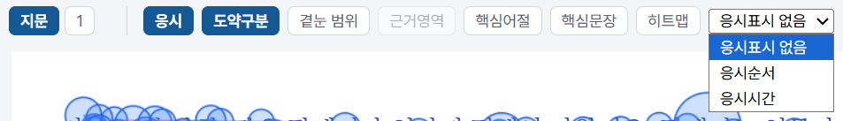
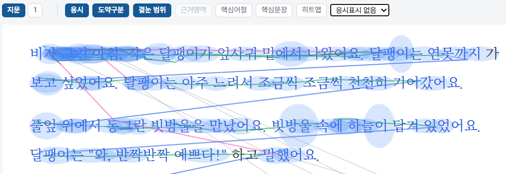
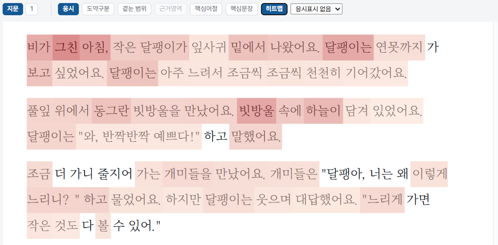
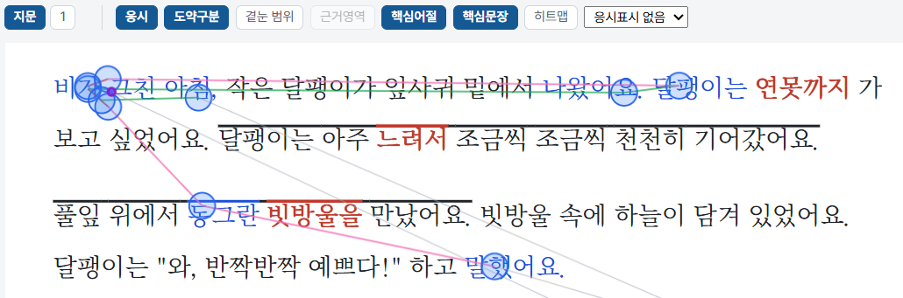
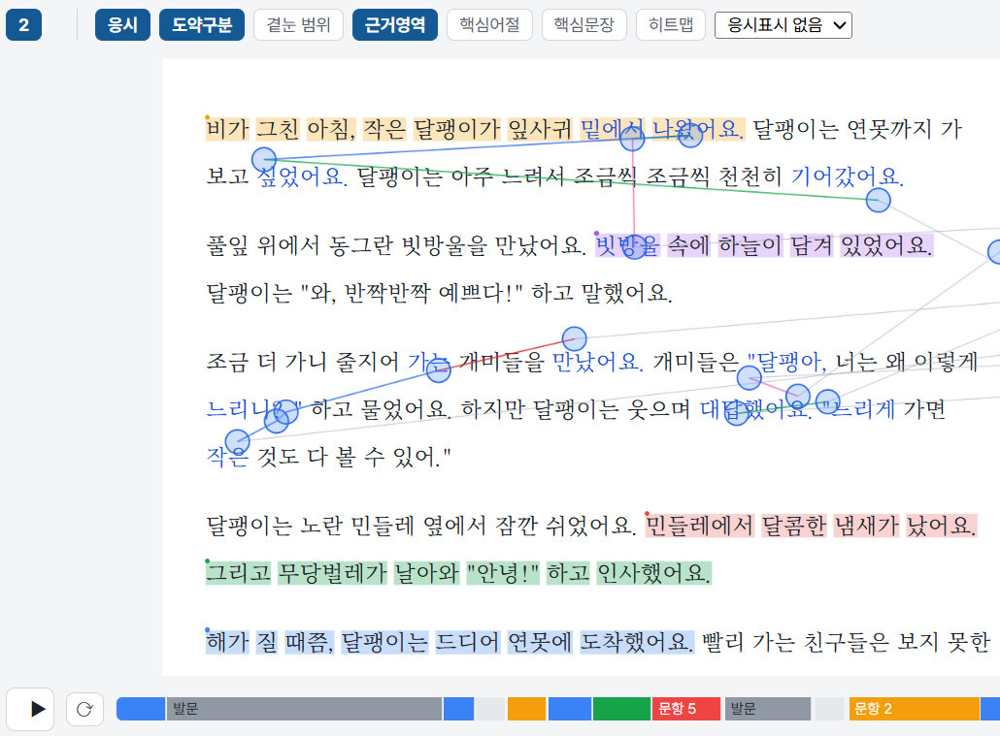
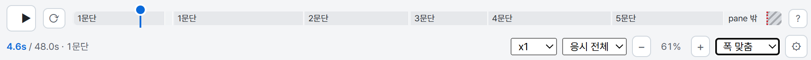
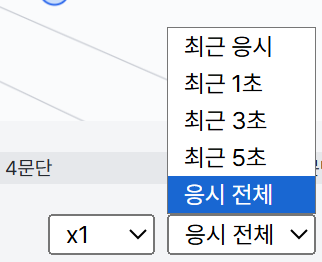
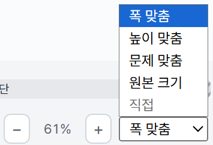
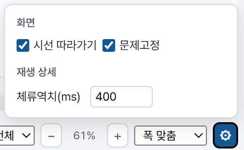

# 읽기 시선 재생 뷰어 사용하기

**읽기 시선 재생 뷰어**는 학생이 글을 읽고 문제를 푸는 동안의 시선을 글 위에 겹쳐서 다시 보여 주는 화면입니다. 다음 화면에서 같은 뷰어를 사용합니다.

* [진단 보고서](result_report.md)의 시선 재생 박스와 \[전체 화면으로 보기]
* 진단 보고서의 소견 카드에 있는 \[실제 읽기에서 보기]
* 관리자 페이지의 [이슈 상세보기](result_admin.md#이슈-상세보기)

화면에 따라 일부 기능은 보이지 않거나 흐리게 표시될 수 있습니다.

## 화면 구성

뷰어는 위에서 아래로 **구간 탭과 표시 버튼**, **글 화면**, **재생 조작 줄**로 이루어져 있습니다.

### 구간 탭

왼쪽 위의 탭으로 어느 구간의 시선을 볼지 고릅니다.

| 탭 | 보여 주는 구간 |
|---|---|
| 지문 | 학생이 글(지문)을 읽은 구간 |
| 1, 2 … | 학생이 해당 번호의 문제를 푼 구간 |

### 표시 버튼

탭 옆의 버튼으로 글 위에 표시할 정보를 켜고 끕니다. 켜진 버튼은 진한 파란색으로 표시되고, 지금 화면에서 쓸 수 없는 버튼은 흐리게 표시됩니다. 여러 버튼을 함께 켤 수 있습니다.

| 버튼 | 글 위에 표시되는 내용 |
|---|---|
| 응시 | 눈이 머문 곳을 원으로 표시합니다. 오래 머문 곳일수록 원이 큽니다. |
| 도약구분 | 눈이 옮겨 간 길(도약)을 종류별로 다른 색의 선으로 구분해서 표시합니다. |
| 겉눈 범위 | 응시한 자리 주변에서 눈에 들어왔을 것으로 보이는 범위를 옅은 파란색으로 표시합니다. |
| 근거영역 | 문제를 푼 구간에서 선택지별 근거 영역을 색으로 표시합니다. |
| 핵심어절 | 글의 핵심 어절을 붉은 글씨로 표시합니다. |
| 핵심문장 | 글의 핵심 문장을 선으로 표시합니다. |
| 히트맵 | 어절마다 시선이 머문 정도를 색의 진하기로 표시합니다. |


\[근거영역]은 문제를 푼 구간(숫자 탭)에서만 쓸 수 있고, \[지문] 탭에서는 흐리게 표시됩니다.


#### 응시 표시 바꾸기

표시 버튼 오른쪽의 \[응시표시] 선택 상자에서 응시 원에 함께 보여 줄 정보를 고릅니다.

<figure><figcaption></figcaption></figure>

| 선택 | 설명 |
|---|---|
| 응시표시 없음 | 원만 표시합니다. (기본) |
| 응시순서 | 응시가 일어난 순서를 함께 표시합니다. |
| 응시시간 | 응시한 시간을 함께 표시합니다. |

## 보기 방식 알아보기

### 응시와 도약

\[응시]와 \[도약구분]을 켜면 학생이 글을 어떤 순서로 읽었는지 볼 수 있습니다. 원은 눈이 머문 곳이고, 선은 눈이 옮겨 간 길입니다. \[겉눈 범위]를 함께 켜면 응시한 자리 주변의 범위가 겹쳐서 표시됩니다.

<figure><figcaption></figcaption></figure>

### 히트맵

어절마다 시선이 머문 정도를 색으로 보여 줍니다. 진한 붉은색일수록 시선이 많이 머문 어절이고, 색이 없는 어절은 눈이 닿지 않은 곳입니다. 글의 어느 부분을 오래 보았고 어느 부분을 건너뛰었는지 한눈에 알 수 있습니다.

<figure><figcaption></figcaption></figure>

### 핵심어절과 핵심문장

글에서 중요한 어절과 문장을 표시하고, 학생의 시선이 그 자리에 닿았는지 확인할 수 있습니다. \[핵심어절]은 핵심 어절을 붉은 글씨로, \[핵심문장]은 핵심 문장을 선으로 표시합니다. \[응시]와 함께 켜면 시선이 핵심 부분에 머물렀는지 볼 수 있습니다.

<figure><figcaption></figcaption></figure>

### 선택지별 근거영역

문제를 푼 구간의 탭(예: \[2])을 선택하고 \[근거영역]을 켜면 글 위에 **선택지별 근거 영역**이 색으로 칠해집니다. 선택지 번호마다 색이 따로 정해져 있어서, 같은 색이 칠해진 자리가 그 선택지의 근거가 되는 곳입니다.

<figure><figcaption></figcaption></figure>

* 학생의 시선이 어느 선택지의 근거 영역에 닿았는지 확인하면, 답을 고르기 전에 근거를 확인했는지 알 수 있습니다.
* 아래의 진행 막대는 문제를 푸는 동안 학생이 무엇을 보았는지를 구간별 색으로 나타냅니다. 문제를 읽은 구간은 \[발문], 선택지를 본 구간은 \[문항 n]으로 표시되고, 선택지마다 근거 영역과 같은 색을 씁니다.

## 재생 조작

화면 맨 아래의 조작 줄로 재생을 조절합니다.

<figure><figcaption></figcaption></figure>

| 조작 | 설명 |
|---|---|
| \[▶] | 재생하고 일시정지합니다. |
| 반복 버튼 | 같은 구간을 되풀이해서 재생합니다. |
| 진행 막대 | 문단별로 나뉘어 있습니다. 눌러서 원하는 시점으로 이동합니다. 빗금으로 표시된 \[pane 밖] 구간은 글 화면 밖을 본 구간입니다. |
| 시간 표시 | 왼쪽 아래에 현재 시간과 전체 시간, 지금 읽고 있는 문단이 표시됩니다. (예: 4.6s / 48.0s · 1문단) |
| \[x1] | 재생 속도를 바꿉니다. |
| \[?] | 사용 방법 안내를 엽니다. |

### 응시 길이 정하기

\[응시 전체] 선택 상자에서 재생 중에 화면에 남겨 둘 응시의 길이를 고릅니다.

<figure><figcaption></figcaption></figure>

| 선택 | 설명 |
|---|---|
| 응시 전체 | 재생한 지점까지의 모든 응시가 남습니다. (기본) |
| 최근 5초, 최근 3초, 최근 1초 | 최근 그 시간 동안의 응시만 남습니다. 짧을수록 자취가 적습니다. |
| 최근 응시 | 가장 최근의 응시만 남습니다. |

### 화면 크기 조절하기

\[−] \[+] 버튼으로 글의 크기를 바꾸며 현재 배율(예: 61%)이 가운데에 표시됩니다. 오른쪽 선택 상자에서 크기를 맞추는 기준을 고릅니다.

<figure><figcaption></figcaption></figure>

| 선택 | 설명 |
|---|---|
| 폭 맞춤 | 화면의 가로폭에 맞춥니다. |
| 높이 맞춤 | 화면의 높이에 맞춥니다. |
| 문제 맞춤 | 문제 화면에 맞춥니다. |
| 원본 크기 | 글의 원래 크기로 보여 줍니다. |

### 재생 설정

오른쪽 끝의 \[⚙] 버튼으로 설정 창을 엽니다.

<figure><figcaption></figcaption></figure>

| 항목 | 설명 |
|---|---|
| 시선 따라가기 | 켜 두면 재생 중에 시선이 있는 곳을 따라 화면이 움직입니다. |
| 문제고정 | 문제를 푼 구간에서 문제 화면을 고정할지 정합니다. |
| 체류역치(ms) | 응시로 표시하는 기준이 되는 머문 시간입니다. 기본값은 400ms입니다. |


뷰어에 보이는 시선은 측정 중 보정되어 저장된 값입니다. 화면 크기와 표시 설정은 보는 방법만 바꾸며 저장된 결과와 점수는 바뀌지 않습니다.

