# 관리자 페이지에서 보기

교사와 기관 관리자는 앱(app.readerseye.com)의 조직도에서 노드를 선택하고 \[읽기진단2] 탭을 열어 결과를 볼 수 있습니다. 어떤 노드를 선택하느냐에 따라 화면이 다릅니다.

| 선택한 노드 | 화면의 성격 |
|---|---|
| 학생 | 한 학생의 읽기 모습을 해석한 **소견과 상태** |
| 그룹, 기관 | 여러 학생의 점수 **분포와 위치**를 비교 |

조직도 위의 \[전체 조회 기간]을 바꾸면 화면에 표시되는 회차의 범위가 바뀝니다. 기본값은 최근 6개월입니다.

## 그룹, 기관 노드에서 보기

그룹이나 기관 노드를 선택하면 학생 여럿의 결과를 한 화면에서 비교할 수 있습니다. 「누구부터 살펴볼까」, 「이 학생은 다른 학생과 무엇이 다른가」를 확인하는 화면입니다. 학생 개인을 해석한 소견이나 이슈는 이 화면에 나오지 않습니다.

<figure>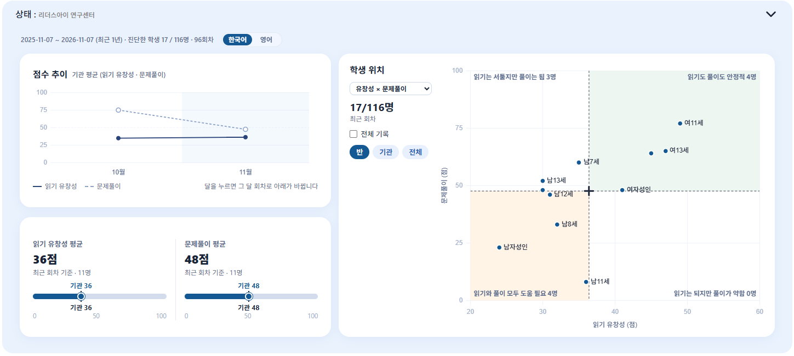<figcaption></figcaption></figure>

화면은 위에서 아래로 \[상태] 박스와 \[진단 기록] 박스로 이어집니다. 가장 위의 줄에서 조회 기간과 회차 수, 진단한 학생 수(예: 17 / 116명)를 확인하고, \[한국어] \[영어] 버튼으로 언어를 바꿀 수 있습니다.

### 점수 추이

<figure>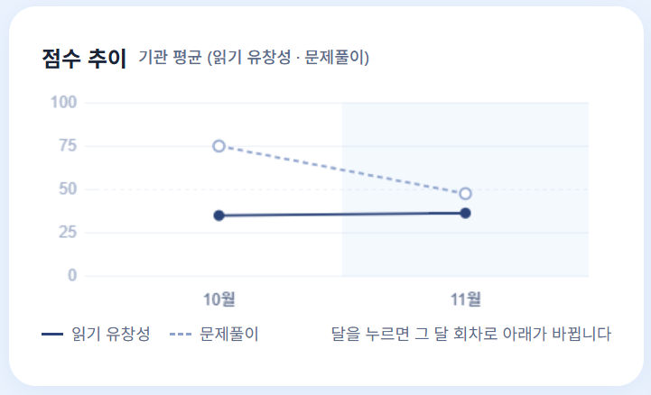<figcaption></figcaption></figure>

달마다 그 달에 측정한 회차의 **평균 점수**를 보여 주는 꺾은선 그래프입니다. 실선은 읽기 유창성, 점선은 문제풀이입니다.

* 그래프의 달(점)을 누르면 아래의 평균 카드와 학생 위치가 **그 달의 회차**를 기준으로 바뀝니다.
* 같은 달을 다시 누르면 학생마다 가장 최근 회차를 기준으로 하는 처음 상태로 돌아갑니다.

### 평균 카드

<figure>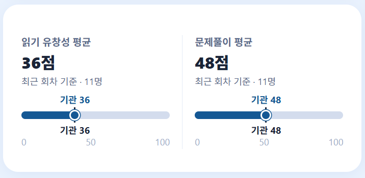<figcaption></figcaption></figure>

읽기 유창성과 문제풀이의 평균 점수를 나란히 보여 줍니다. 아래에는 기준이 된 회차와 인원(예: 최근 회차 기준, 11명)이 표시됩니다.

* 막대 위의 점과 숫자는 선택한 노드의 평균이고, 눈금은 기관 전체의 평균입니다. 기관 노드를 선택하면 두 값이 같습니다.
* 아직 점수가 없는 학생은 평균에서 빠집니다. 평균을 낸 인원은 항상 함께 표시됩니다.

### 학생 위치

<figure>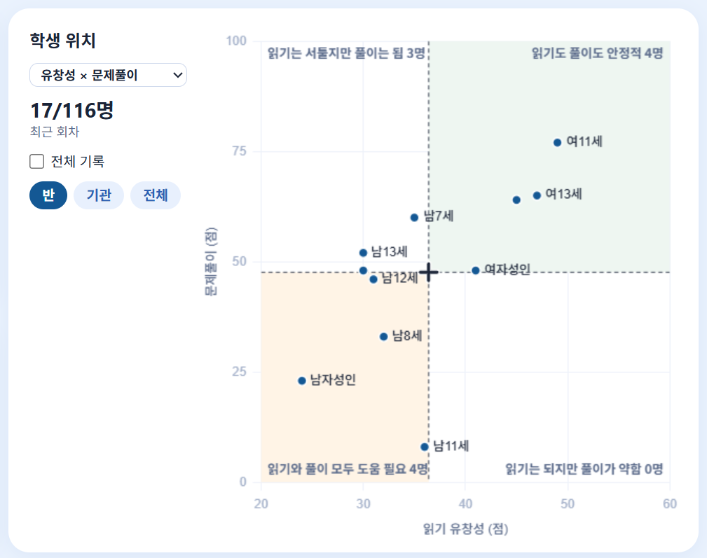<figcaption></figcaption></figure>

학생 한 명을 점 하나로 나타내는 차트입니다. 두 점수를 가로축과 세로축으로 놓고 학생이 어디에 있는지 한눈에 볼 수 있습니다.

* **점을 누르면** 그 학생의 \[읽기진단2] 화면으로 이동합니다.
* 점 옆에는 학생의 이름(또는 닉네임)이 표시됩니다.
* 왼쪽의 \[17/116명]은 선택한 회차 기준으로 결과가 있는 학생 수와 노드에 속한 전체 학생 수입니다. 마우스를 올리면 읽기 지표가 없는 학생과 기간 안에 측정하지 않은 학생의 이름을 확인할 수 있습니다.

#### 차트 축 바꾸기

차트 제목 아래의 선택 상자에서 비교할 축을 고릅니다.

<figure>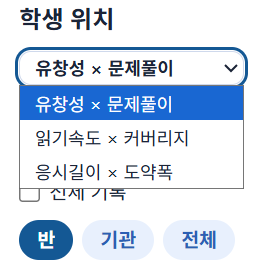<figcaption></figcaption></figure>

| 축 | 비교하는 두 가지 |
|---|---|
| 유창성 × 문제풀이 | 읽기 유창성 점수와 문제풀이 점수 (가로축이 유창성, 세로축이 문제풀이) |
| 읽기속도 × 커버리지 | 읽기 속도와 글을 읽은 비율 |
| 응시길이 × 도약폭 | 눈이 한 번 머문 시간과 눈이 한 번에 건너뛴 폭 |

#### 기준점 고르기

차트에는 검은 십자와 점선이 표시되며, 이 기준점이 네 구역을 나누는 중심이 됩니다. \[반] \[기관] \[전체] 버튼으로 기준점을 바꿉니다. 기본값은 \[반]입니다.

* \[기관]과 \[전체]는 같은 조회 기간, 같은 언어의 평균입니다.


\[기관]과 \[전체] 기준점은 나이와 수준을 나누지 않은 평균입니다. 같은 또래의 평균이 아니므로 또래 비교로 읽지 마세요.


#### 네 구역의 이름

기준점으로 나뉜 네 구역에는 해당하는 학생 수가 함께 표시됩니다.

**유창성 × 문제풀이**

| 위치 | 구역 이름 |
|---|---|
| 오른쪽 위 | 읽기도 풀이도 안정적 |
| 왼쪽 위 | 읽기는 서툴지만 풀이는 됨 |
| 오른쪽 아래 | 읽기는 되지만 풀이가 약함 |
| 왼쪽 아래 | 읽기와 풀이 모두 도움 필요 |

**읽기속도 × 커버리지**: 빠르게 전체를 읽음, 전체를 꼼꼼하게 읽음, 빠르게 듬성듬성 읽음, 느리고 듬성듬성 읽음

**응시길이 × 도약폭**: 빠르고 넓은 시선, 느리고 넓은 시선, 빠르고 좁은 시선, 느리고 좁은 시선


구역 이름은 학생을 분류하는 이름표가 아니라 우선 살펴볼 학생을 찾기 위한 안내입니다. 한 번의 측정 결과이므로 학생의 읽기 능력을 단정하지 마세요.


#### 지난 회차 함께 보기

\[전체 기록]을 체크하면 조회 기간 안의 지난 회차가 학생마다 선으로 이어져 표시됩니다. 오래된 회차일수록 점이 흐리게 보여, 학생의 위치가 어떻게 달라졌는지 확인할 수 있습니다.

### 평균과 점에서 빠지는 경우

* 읽은 글이 절반에 못 미쳐 점수가 없는 회차는 평균에서 빠집니다.
* 시선이 충분히 측정되지 않은 회차(측정률이 낮은 회차)도 평균에서 빠집니다.
* 읽기 구간이 없는 회차는 \[유창성 × 문제풀이] 차트에서 유창성 0점 위치에 회색 점으로 표시되고, 나머지 두 축에서는 점이 나타나지 않습니다.
* 선생님 계정은 기본그룹과 배정된 그룹의 학생만 볼 수 있습니다. 기관 기준점은 기관 전체의 값입니다.
* 학생이 반을 옮겼다면 지금 소속을 기준으로 표시되며, 측정 당시의 소속은 알 수 없습니다.

### 진단 기록

화면 맨 아래의 \[진단 기록] 박스에서 회차 목록을 볼 수 있습니다. 목록에는 학생 열이 있어 누구의 기록인지 알 수 있고, 열 제목을 눌러 정렬하거나 이름으로 검색할 수 있습니다. 목록의 자세한 사용법은 [진단 기록 보기](#진단-기록-보기)을 참고하세요.

## 학생 노드에서 보기

학생을 선택하면 그 학생 한 명의 읽기 모습을 해석한 화면이 열립니다. 위에서 아래로 \[소견과 상태] 박스, \[소견 관련 이슈] 박스, \[진단 기록] 박스로 구성됩니다.

### 소견과 상태

<figure>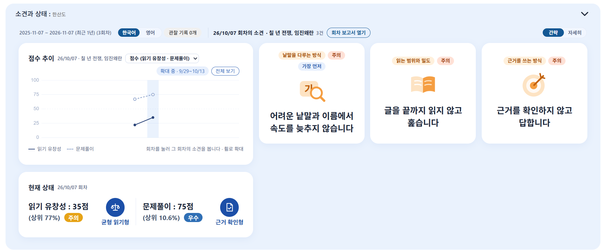<figcaption></figcaption></figure>

넓은 화면에서는 왼쪽에 점수 추이와 현재 상태가, 오른쪽에 소견 카드가 나란히 표시됩니다. 화면이 좁으면 위아래로 쌓입니다.

**윗줄**

* 조회 기간과 회차 수(예: 최근 1년, 3회차), 언어 전환 버튼이 있습니다.
* \[관찰 기록 n개]: 교사가 남긴 학생 기록이 있으면 개수가 표시되며, 눌러서 기록을 볼 수 있습니다.
* 선택한 회차의 날짜와 글 제목, 소견 개수가 표시되고 바로 옆에 **\[회차 보고서 열기]** 버튼이 있습니다. 이 버튼으로 그 회차의 [진단 보고서](result_report.md)를 엽니다.
* 오른쪽 끝의 **\[간략 | 자세히]** 스위치로 소견, 이슈, 현재 상태 카드를 한꺼번에 앞면(간략)과 뒷면(자세히)으로 바꿉니다. 선택한 보기는 이 브라우저에 기억됩니다.

#### 점수 추이

<figure>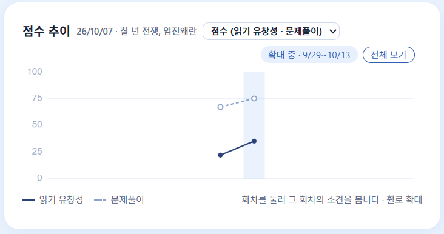<figcaption></figcaption></figure>

회차별 점수를 꺾은선으로 보여 줍니다. 실선은 읽기 유창성, 점선은 문제풀이입니다.

* 회차(점)를 누르면 **그 회차가 선택**되고, 선택한 회차는 파란 띠로 표시됩니다. 현재 상태와 소견이 그 회차 기준으로 바뀝니다. 기본은 가장 최근 회차입니다.
* 마우스 휠로 그래프를 확대할 수 있습니다. 확대하면 보고 있는 기간이 \[확대 중]으로 표시되며, \[전체 보기]를 누르면 처음 범위로 돌아갑니다.
* 제목 옆의 선택 상자에서 지표 하나를 고르면 그 지표의 회차별 추이로 바뀝니다. 지표 그래프에는 적정 범위를 나타내는 색 띠가 깔리며, 이 색 띠는 잠정 기준입니다.
* 회차가 하나뿐이면 점이 하나로 보이고, 회차가 쌓이면 변화가 나타납니다.

#### 현재 상태

선택한 회차를 기준으로 읽기 유창성과 문제풀이가 나란히 표시됩니다. 보기 방식에 따라 보이는 내용이 다릅니다.

| 보기 | 내용 |
|---|---|
| 간략 | 점수, 추정 상위 %와 등급(우수, 보통, 주의, 위험), 유형 이름(예: 균형 읽기형, 근거 확인형) |
| 자세히 | 점수 분포 곡선과 내 점수, 유형 설명, 유형 근거, 다음 진단을 권하는 시기와 이유 |

**자세히** 보기에서는 다음 내용을 확인할 수 있습니다.

<figure>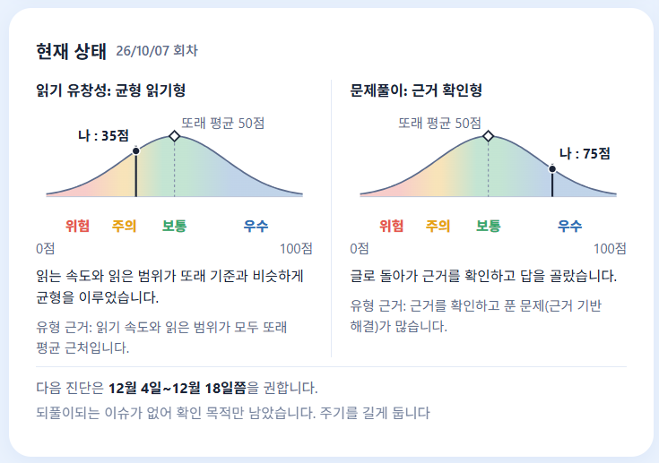<figcaption></figcaption></figure>

* **점수 분포 곡선**: 점수를 위험, 주의, 보통, 우수 구간으로 나누어 색으로 보여 줍니다. 곡선 위에 \[나]의 점수와 \[또래 평균 50점]이 표시됩니다.
* **유형 설명과 유형 근거**: 이 학생의 읽는 방식 또는 문제를 푸는 방식을 한 줄로 설명하고, 어떤 관찰을 바탕으로 정해졌는지 근거를 보여 줍니다.
* **다음 진단 권장 시기**: 「다음 진단은 12월 4일~12월 18일쯤을 권합니다.」처럼 날짜 범위와 그 이유가 표시됩니다.


점수 분포 곡선, 상위 %, 등급은 기준 데이터를 모으는 중이라 **추정**입니다. 점수는 나이와 글의 레벨에 상관없이 같은 기준으로 계산되며, 기준 데이터가 쌓이면 점수는 그대로이고 상위 %와 등급만 더 정확해집니다. 상위 %는 숫자가 낮을수록 잘한 것입니다.


#### 소견

소견은 선택한 회차 하나에서 **주제 하나**를 지표와 이슈로 종합한 의견입니다. 한 회차에 보통 4장이 나옵니다. 앞면에는 주제와 \[주의] 또는 \[좋음] 표시, 큰 제목이 나옵니다. \[자세히]로 바꾸면 카드가 돌아서 뒷면이 나옵니다.

<figure>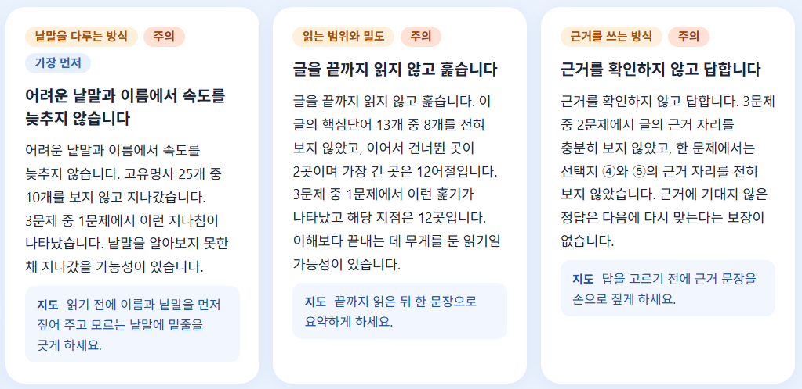<figcaption></figcaption></figure>

뒷면에는 다음 내용이 있습니다.

* **본문**: 시선 기록에서 관찰된 내용을 구체적인 숫자와 함께 설명합니다.
* **지도**: 가정이나 교실에서 해 볼 수 있는 지도 방향을 제안합니다.

그 밖에 알아 둘 점은 다음과 같습니다.

* 가장 먼저 살펴볼 소견에는 \[가장 먼저] 표시가 붙습니다.
* 카드를 누르면 아래 \[소견 관련 이슈]가 그 소견의 근거가 되는 이슈로 좁혀집니다. 같은 카드를 다시 누르면 풀립니다.
* 소견이 아직 만들어지지 않은 회차는 \[소견 준비 중]으로 표시됩니다.
* 가장 최근 회차를 볼 때는 마지막 회차에 처음 나타난 소견에 \[새로 보임], 이전 회차에도 있던 소견에 \[계속됨]이 표시됩니다.
* 최근 회차에는 없지만 이전에 2회 이상 나타났던 **주의 소견**은 목록 맨 뒤에 흐리게 한 장 표시됩니다.


이전에 나타났던 소견이 최근 회차에 보이지 않는 것은 문제가 **해결되었다는 뜻이 아닙니다.** 이번 회차에 나타나지 않았다는 뜻이며, 다음 회차에 다시 나타날 수 있습니다.


### 소견 관련 이슈

**이슈**는 시선 기록에서 찾아낸 읽기 모습 하나입니다. 학생을 평가하지 않고 관찰한 내용을 적습니다. (예: 고유명사를 보지 않고 지나갔습니다.)

<figure>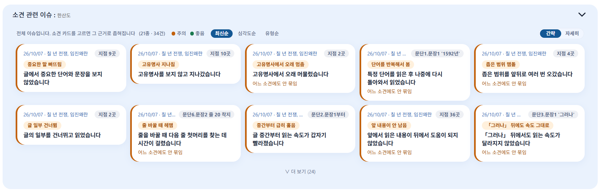<figcaption></figcaption></figure>

**이슈 카드 읽는 법**

* 카드 위쪽에는 측정 날짜와 글 제목, 그리고 이슈가 나타난 위치(예: 지점 9곳, 문단1.문장1 '1592년')가 표시됩니다.
* 색 칩에 이슈 이름이, 그 아래에 한 줄 제목이 나옵니다.
* 카드 왼쪽 막대의 색이 성격을 나타냅니다. 주황은 살펴볼 점(주의), 초록은 잘하고 있는 점(좋음)입니다.
* 어느 소견과도 이어지지 않은 이슈에는 \[어느 소견에도 안 묶임]이라고 표시됩니다.
* 같은 회차에서 같은 종류의 이슈는 한 장으로 묶여 표시됩니다.

**목록 조작**

* 소견 카드를 고르지 않았을 때는 「전체 이슈입니다」라는 안내와 함께 종류 수와 건수(예: 21종, 34건)가 표시됩니다. 소견 카드를 고르면 그 소견의 근거 이슈로 좁혀집니다.
* 처음에는 두 줄까지만 보이며, \[더 보기]와 \[접기]로 펼치고 접을 수 있습니다.
* 정렬은 \[최신순], \[심각도순], \[유형순] 중에서 고릅니다. 점수 추이에서 고른 회차의 카드는 어느 정렬에서도 맨 앞에 하늘색으로 표시됩니다.
* 시선 표본이 모자라 판단할 수 없는 경우는 이슈가 없는 것이 아니라 \[판정 불가]로 표시됩니다.

**자세히 보기**

\[자세히]로 바꾸면 카드가 돌아서 이슈에 대한 설명이 나옵니다.

<figure>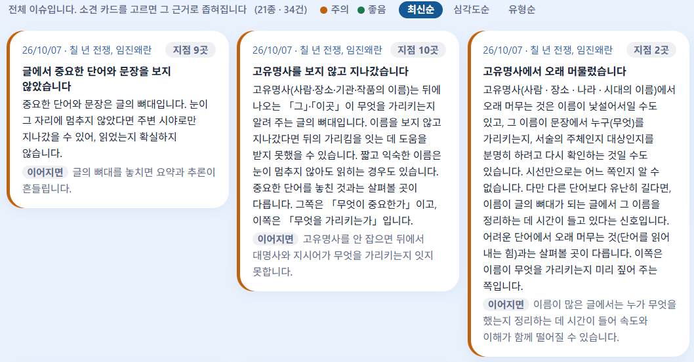<figcaption></figcaption></figure>

* **설명**: 이 이슈가 무엇을 뜻하고 왜 살펴볼 점인지 설명합니다. 잘하고 있는 점이면 왜 좋은지 설명합니다.
* **이어지면**: 이런 모습이 이어질 때 생길 수 있는 영향을 알려 줍니다.

### 이슈 상세보기

이슈 카드를 누르면 상세 창이 열립니다. 학생이 그 이슈가 나타난 대목을 읽을 때의 시선을 글 위에서 직접 확인할 수 있습니다.

<figure>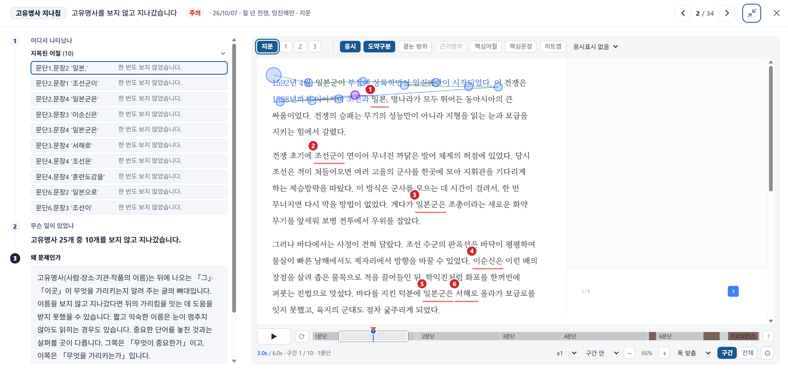<figcaption></figcaption></figure>

**창 위쪽**

* 이슈 이름, 제목, 성격 표시(주의 또는 좋음), 측정 날짜와 글 제목이 표시됩니다.
* 오른쪽의 \[‹] \[›] 버튼과 \[2 / 34] 표시로 다른 이슈로 넘어갈 수 있습니다. 키보드의 좌우 방향키도 사용할 수 있습니다.
* 닫으려면 \[✕]를 누르거나 ESC 키를 누르세요. 창 밖을 눌러도 닫힙니다.

**왼쪽: 이슈 설명**

위에서 아래로 번호 순서대로 읽습니다.

1. **어디서 나타났나**: 이슈가 지목한 어절의 목록입니다. 어절마다 위치(문단과 문장)와 시선의 상태(예: 한 번도 보지 않았습니다)가 표시됩니다. 어절을 누르면 오른쪽의 글과 시선 장면이 그 어절로 바뀝니다.
2. **무슨 일이 있었나**: 관찰된 내용을 한 문장으로 요약합니다. (예: 고유명사 25개 중 10개를 보지 않고 지나갔습니다.)
3. **왜 문제인가**: 이 이슈가 읽기에 어떤 영향을 줄 수 있는지 설명합니다. 잘하고 있는 점이면 \[왜 좋은가]로 나옵니다.

아래로 내리면 추가 설명이 이어집니다.

**오른쪽: 글 위의 시선**

* 글 위에 학생의 시선이 겹쳐서 표시됩니다. 원은 눈이 머문 곳(응시)이고, 선은 눈이 옮겨 간 길입니다. 지목된 어절에는 번호와 밑줄이 붙습니다.
* 위쪽의 탭으로 보고 싶은 구간을 고릅니다. \[지문]은 글을 읽은 구간이고, 숫자는 문제를 푼 구간입니다.
* \[응시], \[도약구분], \[겉눈 범위], \[근거영역], \[핵심어절], \[핵심문장], \[히트맵] 버튼으로 글 위에 표시할 정보를 켜고 끌 수 있습니다. 이슈에 따라 쓸 수 없는 버튼은 흐리게 표시됩니다.

**재생 조작**

각 버튼과 재생 조작의 자세한 설명은 [읽기 시선 재생 뷰어 사용하기](gaze_viewer.md)를 참고하세요.

* 맨 아래의 \[▶] 버튼으로 재생하고, 옆의 반복 버튼으로 같은 구간을 되풀이해서 봅니다.
* 진행 막대는 문단별로 나뉘어 있으며, 눌러서 원하는 시점으로 이동할 수 있습니다. 현재 시간과 전체 시간이 함께 표시됩니다.
* 재생 속도를 정할 수 있고, \[구간]과 \[전체]로 이슈가 나타난 구간만 볼지 전체 시선을 볼지 바꿉니다.
* \[−] \[+]와 \[폭 맞춤]으로 글의 크기를 조절합니다.

이슈를 처음 열면 움직임이 근거인 이슈(예: 글 중간부터 급히 훑음)는 해당 구간이 자동으로 반복 재생되고, 오래 머문 것이 근거인 이슈(예: 고유명사에서 오래 머묾)는 지목 어절 중심의 정지 화면으로 열립니다.

### 진단 기록 보기

화면 맨 아래의 \[진단 기록]에서 회차 목록을 볼 수 있습니다. 한 회차가 한 행이며, 언제 어떤 글로 진단했는지 확인하는 관리용 목록입니다.

| 보기 | 표시되는 열 |
|---|---|
| 간략(기본) | 날짜, 지문, 진단 당시 나이, 유창성, 문제풀이, 정답 |
| 자세히 | 수준, 영역, 갈래, 커버리지, 상태 등 전체 열과 \[분석 데이터 받기], \[컬럼] 버튼 |

* 진단 당시 나이는 「10.8세」처럼 표시되고, 값이 없으면 \[미상]으로 나옵니다.
* 읽은 글이 절반에 못 미친 회차는 행이 남고 점수만 \[점수 없음]으로 표시됩니다.
* \[분석 데이터 받기]는 한 회차의 어절표, 타임라인, 이슈를 엑셀 파일로 내려받습니다.
* 학부모에게 보낼 **진단 보고서**는 \[소견과 상태] 박스의 \[회차 보고서 열기] 버튼으로 열 수 있습니다. 보고서 화면은 [진단 보고서에서 보기](result_report.md)를 참고하세요.


측정률이 낮은 회차와 점수가 없는 회차도 진단 기록, 점수 추이, 이슈, 소견에는 그대로 남습니다. 그룹과 기관 노드의 평균에서만 빠집니다.

