# 진단 보고서에서 보기

**진단 보고서**는 학생이 읽기진단2를 한 번 마칠 때마다 만들어지는, **한 회차의 결과**를 담은 보고서입니다. 교사가 링크를 만들어 학부모에게 보내면 학부모가 휴대폰으로 편하게 볼 수 있도록 구성되어 있습니다.

* 보고서에는 **그 회차 한 건의 결과만** 담깁니다. 이전 회차와의 변화나 반복된 이슈는 [관리자 페이지](result_admin.md)에서 확인합니다.
* 다른 학생과의 비교, 교사의 기록, 기관의 운영 정보는 담기지 않습니다.

## 보고서 전달하기

교사는 학생 노드의 \[읽기진단2] 화면에서 \[회차 보고서 열기] 버튼으로 보고서를 열고, 링크를 학부모에게 전달합니다. 링크를 만들 때 다음 두 가지를 고릅니다.

| 항목 | 설명 |
|---|---|
| 익명 | 켜면 학생 이름, 아이디, 진단 당시 나이, 기관 같은 정보가 보고서에서 가려집니다. 진단한 날짜는 보입니다. |
| 유효기간 | 링크를 열 수 있는 기간입니다. 기간이 지나면 만료 안내 화면이 나타납니다. |


* 링크를 아는 사람은 누구나 보고서를 열 수 있습니다. 안전한 방법으로 전달해 주세요.
* 익명으로 만들어도 진단 날짜, 지문, 기관을 아는 사람은 학생을 짐작할 수 있습니다. 이름만 가렸다고 완전히 익명이 되는 것은 아닙니다.
* 보고서는 링크를 열 때마다 저장된 결과를 읽어서 보여 줍니다. 같은 회차를 **재분석하면 이미 보낸 링크의 내용도 바뀔 수 있습니다.**


## 보고서의 구성

보고서는 위에서 아래로 다음과 같이 구성됩니다.

| 순서 | 영역 | 내용 |
|---|---|---|
| 1 | 진단 정보 | 학생, 진단 당시 나이, 일시, 기관, 읽은 글과 함께 학생이 읽는 동안의 시선을 다시 볼 수 있는 **시선 재생** |
| 2 | 총평 | 읽기 유창성과 문제풀이의 **상태 요약**, 그리고 AI가 쓴 **총평** |
| 3 | 유창성 분석 | 점수 분포, 독서가 유형, 소견, 「글을 읽은 모습」 지표 |
| 4 | 문제풀이 분석 | 점수 분포, 문제풀이 유형, 소견, 문제별 결과, 「문제를 푼 모습」 지표 |

휴대폰에서는 한 줄로, 넓은 화면에서는 영역 안의 박스가 최대 두 줄로 배치됩니다. 화면이 넓으면 왼쪽에, 좁으면 오른쪽 아래의 버튼으로 차례를 열어 원하는 영역으로 바로 이동할 수 있습니다.

## 진단 정보

<figure>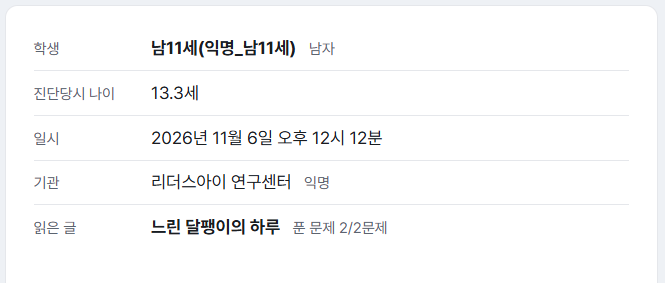<figcaption></figcaption></figure>

학생, 진단 당시 나이, 일시, 기관, 읽은 글이 표시됩니다. 읽은 글 옆에는 푼 문제 수(예: 푼 문제 2/2문제)가 함께 나옵니다. 익명으로 만든 링크에서는 학생 이름과 기관 이름 대신 \[익명]으로 표시됩니다.

### 시선 재생

<figure>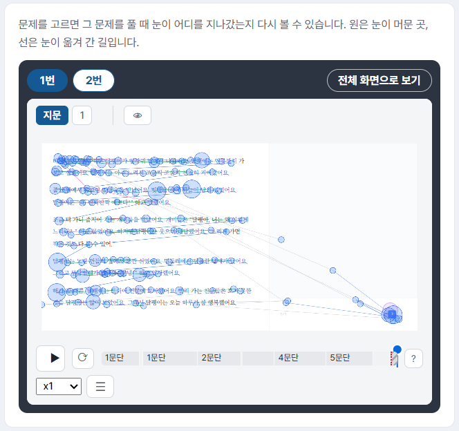<figcaption></figcaption></figure>

학생이 읽는 동안의 시선을 영상처럼 다시 볼 수 있습니다. 원은 눈이 머문 곳이고, 선은 눈이 옮겨 간 길입니다.

* 위쪽의 **\[1번] \[2번]** 같은 버튼으로 문제를 고르면 그 문제를 풀 때 눈이 지나간 자리를 볼 수 있습니다.
* 화면 안의 탭으로 \[지문]을 읽은 구간과 문제를 푼 구간을 바꿔서 볼 수 있습니다.
* \[▶]로 재생하고, 아래의 진행 막대로 원하는 문단으로 이동할 수 있습니다. 재생 속도도 바꿀 수 있습니다.
* \[전체 화면으로 보기]를 누르면 화면을 크게 볼 수 있습니다. 휴대폰에서는 가로로 돌려서 보세요.
* 표시 버튼과 재생 조작의 자세한 설명은 [읽기 시선 재생 뷰어 사용하기](gaze_viewer.md)를 참고하세요.

## 총평 보기

### 상태 요약

읽기 유창성과 문제풀이 각각에 대해 카드 한 장이 나옵니다.

<figure>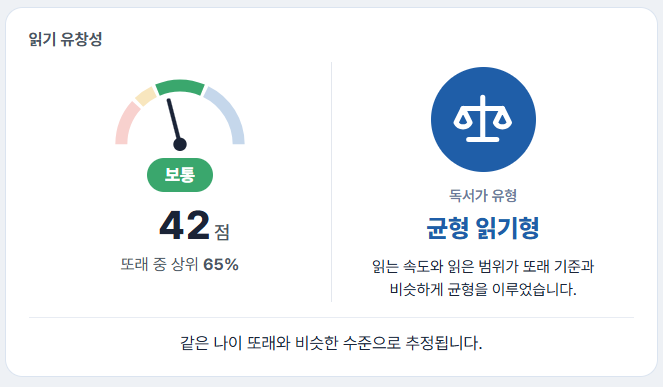<figcaption></figcaption></figure>

<figure>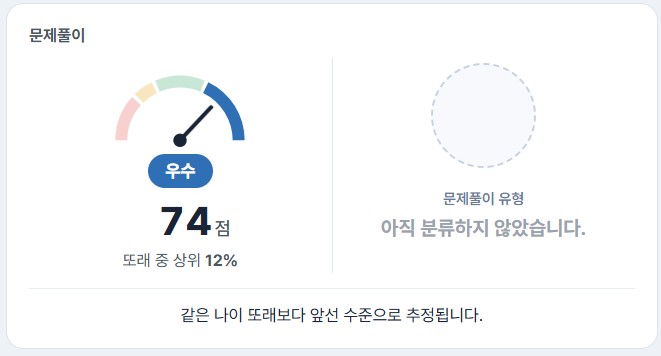<figcaption></figcaption></figure>

* **점수**: 반원 모양의 게이지에 바늘이 점수 위치를 가리킵니다. 게이지는 위험, 주의, 보통, 우수 구간으로 나뉘며 바늘 아래에 현재 등급과 점수, 또래 중 상위 %가 표시됩니다.
* **유형**: 읽는 방식(독서가 유형) 또는 문제를 푸는 방식(문제풀이 유형)의 이름과 한 줄 설명이 표시됩니다. 유형을 정할 만한 기록이 부족하면 「아직 분류하지 않았습니다」로 표시됩니다.
* 카드 맨 아래에는 같은 나이 또래와 견준 수준을 한 줄로 설명합니다. (예: 같은 나이 또래와 비슷한 수준으로 추정됩니다.)


점수는 나이나 글의 레벨과 상관없이 같은 기준으로 계산됩니다. 등급과 상위 %만 같은 나이 또래와 견준 값이며, 기준 데이터를 모으는 중이라 **추정**입니다. 상위 %는 숫자가 **낮을수록** 잘한 것입니다.


### AI 총평

상태 요약 아래에 네 장의 카드로 나옵니다. 학부모가 읽는 글이므로 전문 용어 없이 쉬운 말로 적습니다. 카드마다 굵은 글씨의 요점과 그 아래 설명이 이어집니다.

| 카드 | 내용 |
|---|---|
| 지금 어떤 상태인가 | 이번 진단에서 관찰된 읽기와 문제풀이의 모습 |
| 학습에 미치는 영향 | 이런 모습이 학습에 줄 수 있는 영향 |
| 이런 상태의 원인으로 짐작되는 것 | 관찰된 행동에서 짐작한 원인 |
| 앞으로 해 보실 것 | 가정에서 해 볼 수 있는 지도 방법 |

<figure>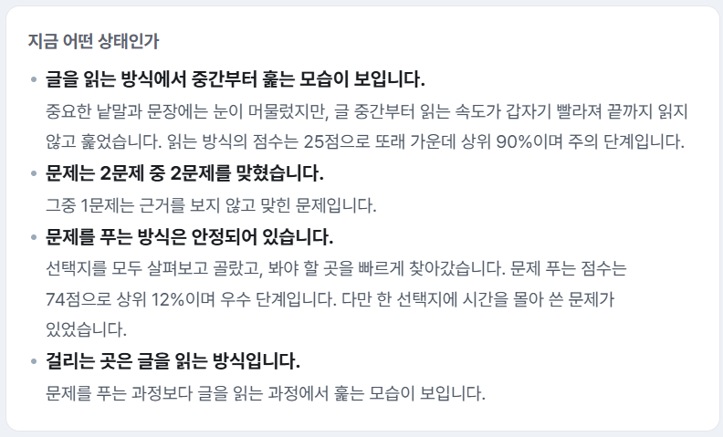<figcaption></figcaption></figure>

<figure>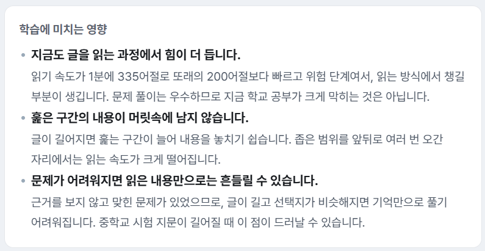<figcaption></figcaption></figure>

<figure>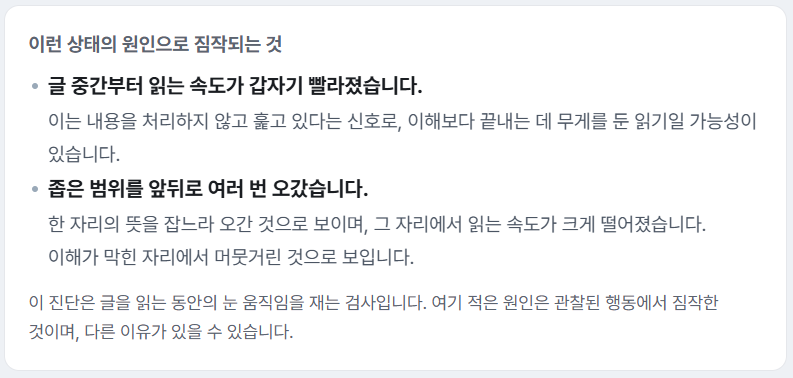<figcaption></figcaption></figure>

<figure>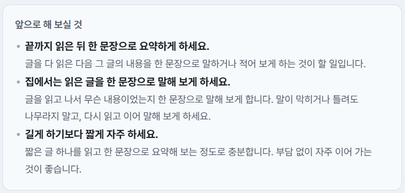<figcaption></figcaption></figure>


원인 카드 맨 아래에는 「이 진단은 글을 읽는 동안의 눈 움직임을 재는 검사입니다. 여기 적은 원인은 관찰된 행동에서 짐작한 것이며, 다른 이유가 있을 수 있습니다.」라는 안내가 늘 함께 나옵니다. 총평은 진단명이나 원인을 단정하지 않습니다.


* 총평은 진단이 끝난 직후 한 번 만들어져 저장됩니다. 만드는 중에는 준비 중 문구가 보이다가 완성되면 채워집니다.
* 이전에 진단한 회차는 총평이 만들어지기 전까지 준비 중 문구로 보일 수 있습니다.
* 같은 문서를 읽은 또래 기록이 적어도 총평은 나옵니다.

## 유창성 분석

### 점수 분포

<figure>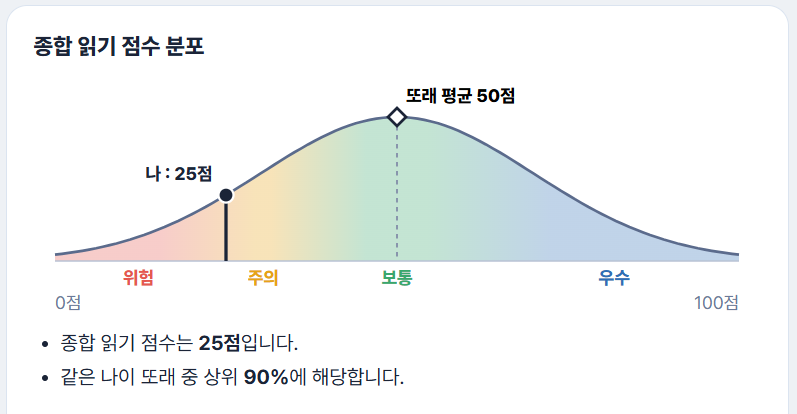<figcaption></figcaption></figure>

점수가 어느 구간에 있는지 곡선 위에 보여 줍니다.

* 곡선은 위험, 주의, 보통, 우수 구간으로 색이 나뉩니다.
* \[나]는 이번 점수의 위치이고, 마름모(◇)는 또래 평균 50점입니다.
* 곡선 아래에 점수와 같은 나이 또래 중 상위 %가 글로 정리됩니다.

### 독서가 유형

<figure>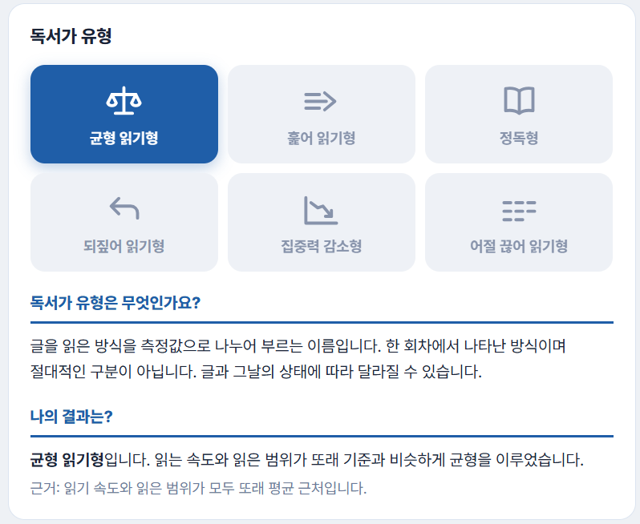<figcaption></figcaption></figure>

유형은 글을 읽는 방식을 요약한 이름입니다. 진단 결과를 바탕으로 정해지며 소견을 대신하지 않습니다.

* 여섯 가지 유형 가운데 이번 결과에 해당하는 유형이 진하게 표시됩니다.
* \[독서가 유형은 무엇인가요?]에서 유형의 뜻을, \[나의 결과는?]에서 이번 유형과 그 근거를 설명합니다.
* 유형은 한 회차에서 나타난 방식이며 절대적인 구분이 아닙니다. 글과 그날의 상태에 따라 달라질 수 있습니다.

| 구분 | 유형 |
|---|---|
| 독서가 유형(읽는 방식) | 균형 읽기형, 훑어 읽기형, 정독형, 되짚어 읽기형, 집중력 감소형, 어절 끊어 읽기형 |
| 문제풀이 유형 | 서둘러 풀이형, 탐색 어려움형, 해석 어려움형, 직감 풀이형, 근거 확인형 |


유형 이름은 원인을 말하는 것이 아니라 관찰된 읽기 방식을 요약한 것입니다. 예를 들어 「집중력 감소형」은 글의 뒤로 갈수록 읽은 범위가 줄었다는 관찰을 뜻하며, 집중력이 부족하다는 판단이 아닙니다.


### 소견 카드

<figure>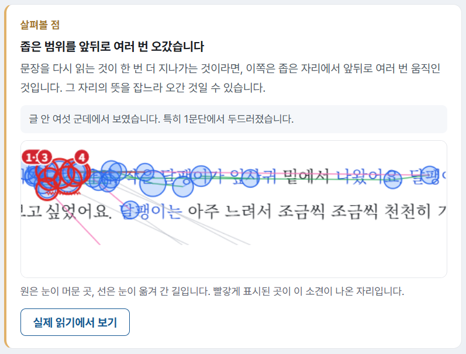<figcaption></figcaption></figure>

점수와 유형 아래에는 이 회차에서 눈에 띈 읽기 모습이 카드로 나옵니다.

* 잘하고 있는 점은 초록, \[살펴볼 점]은 주황으로 구분됩니다. 영역마다 최대 5장까지 나오며, 살펴볼 점이 없으면 「특이사항이 없습니다」로 표시됩니다.
* 카드에는 제목, 설명, 그 모습이 글 안에서 몇 군데에서 나타났는지가 정리되어 있습니다.
* 시선이 머문 모습이 그림으로 함께 나옵니다. 원은 눈이 머문 곳이고, 선은 눈이 옮겨 간 길입니다. **빨갛게 표시된 곳**이 이 소견이 나온 자리입니다.
* \[실제 읽기에서 보기]를 누르면 그 대목의 시선을 재생해서 볼 수 있습니다.

### 글을 읽은 모습

글을 읽는 동안의 시선을 지표별로 보여 줍니다.

<figure>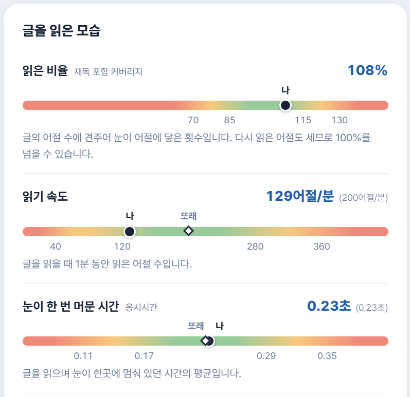<figcaption></figcaption></figure>

<figure>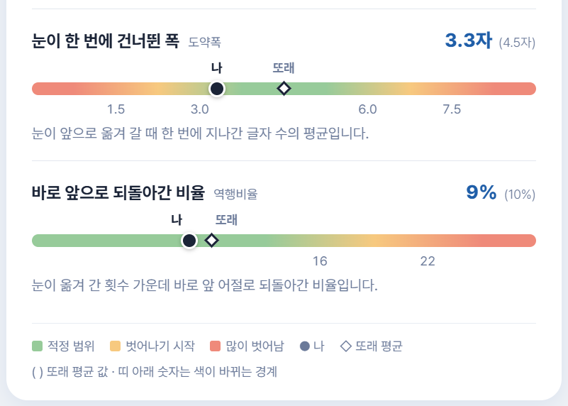<figcaption></figcaption></figure>

**지표 읽는 법**

* 지표마다 쉬운 이름과 작은 글씨의 용어, 이번 값, 괄호 안의 또래 평균, 한 줄 설명, **적정 범위 색 띠**가 나옵니다.
* 색 띠에서 **초록은 적정 범위**, 노랑은 벗어나기 시작한 구간, 빨강은 많이 벗어난 구간입니다.
* **검은 점(●)이 나**, **마름모(◇)가 또래 평균**입니다.
* 띠 아래의 숫자는 색이 바뀌는 경계값입니다.
* 「읽은 비율」은 또래 평균 없이 나만 표시됩니다.

| 화면 이름 | 뜻 | 좋은 방향 |
|---|---|---|
| 읽은 비율 | 글의 어절 수에 견주어 눈이 어절에 닿은 횟수입니다. 다시 읽은 어절도 세므로 100%를 넘을 수 있습니다. | 100% 근처 |
| 읽기 속도 | 글을 읽을 때 1분 동안 읽은 어절 수입니다. | 중간 |
| 눈이 한 번 머문 시간 | 글을 읽으며 눈이 한곳에 멈춰 있던 시간의 평균입니다. 너무 길면 한 어절을 오래 붙들고, 너무 짧으면 훑어 읽는 것입니다. | 중간 |
| 눈이 한 번에 건너뛴 폭 | 눈이 앞으로 옮겨 갈 때 한 번에 지나간 글자 수의 평균입니다. | 중간 |
| 바로 앞으로 되돌아간 비율 | 눈이 옮겨 간 횟수 가운데 바로 앞 어절로 되돌아간 비율입니다. | 낮을수록 |


읽기 속도가 빠를수록, 눈이 넓게 건너뛸수록 좋은 것은 아닙니다. 훑어 읽으면 빠르고 넓게 읽힙니다. 읽기 속도, 눈이 한 번 머문 시간, 건너뛴 폭은 **중간(적정 범위)이 좋은 지표**입니다.


## 문제풀이 분석

문제풀이 분석도 점수 분포와 문제풀이 유형으로 시작하며, 보는 방법은 [유창성 분석](#유창성-분석)과 같습니다.

### 문제별 결과

<figure>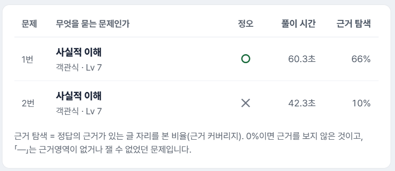<figcaption></figcaption></figure>

문제마다 한 줄로 결과를 정리합니다.

| 열 | 설명 |
|---|---|
| 문제 | 문제 번호 |
| 무엇을 묻는 문제인가 | 문제가 묻는 내용의 종류(예: 사실적 이해), 문제 형식(예: 객관식), 레벨 |
| 정오 | 정답이면 ○, 오답이면 ✕ |
| 풀이 시간 | 문제를 푸는 데 걸린 시간 |
| 근거 탐색 | 정답의 근거가 있는 글 자리를 본 비율입니다. 0%이면 근거를 보지 않은 것이고, 「—」는 근거 영역이 없거나 잴 수 없었던 문제입니다. |

번호만으로 열리는 공개 화면이므로 **정답 번호는 보이지 않습니다.**

### 문제의 소견 카드

<figure>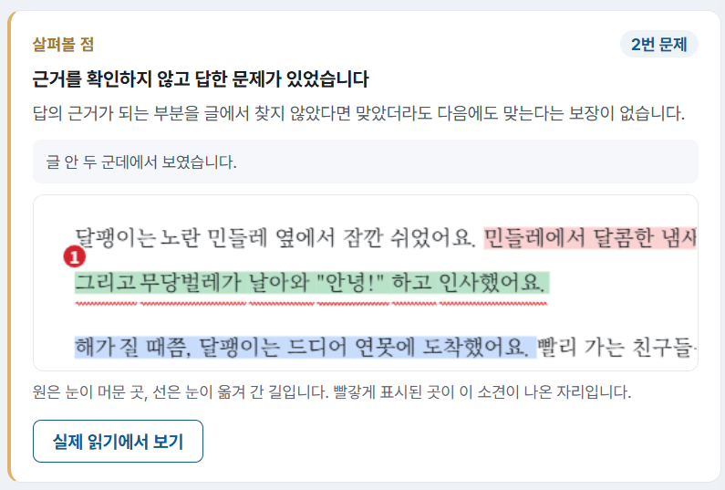<figcaption></figcaption></figure>

문제를 푸는 모습에서 눈에 띈 점은 카드로 나옵니다. 어느 문제에서 나타났는지 카드 오른쪽 위에 \[2번 문제]처럼 표시됩니다. 글 위에 칠해진 색은 **선택지별 근거 영역**입니다. 선택지 번호마다 색이 따로 정해져 있어서, 같은 색이 칠해진 자리가 그 선택지의 근거가 되는 곳입니다. 빨간 번호와 밑줄로 표시된 곳은 이 소견이 나온 자리입니다. 시선이 이 근거 영역에 닿았는지 보면 학생이 답을 고르기 전에 근거를 확인했는지 알 수 있습니다. 정오와 근거를 본 정도를 함께 읽어 한 일만 적고, 학생을 탓하는 표현은 쓰지 않습니다.

* 근거를 보고 맞힘
* 근거를 보지 않고 맞힘
* 근거를 봤는데 틀림
* 근거를 찾지 못하고 틀림
* 판정할 수 없음

### 문제를 푼 모습

문제를 푸는 동안의 시선을 지표별로 보여 줍니다. 읽는 방법은 「글을 읽은 모습」과 같습니다.

<figure>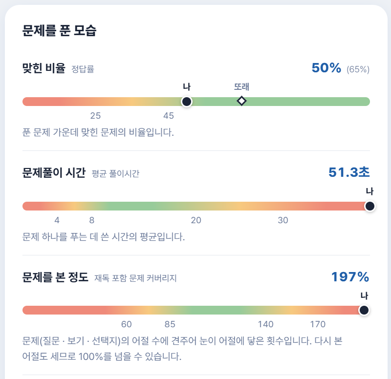<figcaption></figcaption></figure>

<figure>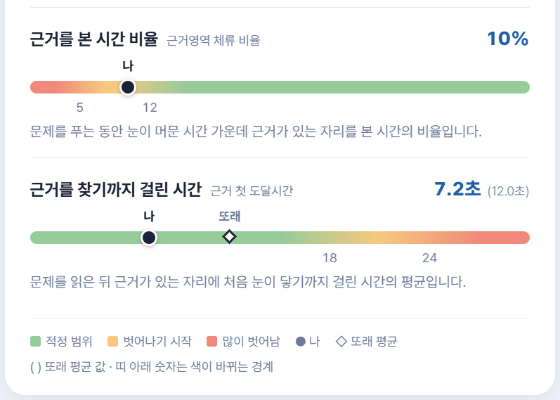<figcaption></figcaption></figure>

| 화면 이름 | 뜻 | 좋은 방향 |
|---|---|---|
| 맞힌 비율 | 푼 문제 가운데 맞힌 문제의 비율입니다. | 높을수록 |
| 문제풀이 시간 | 문제 하나를 푸는 데 쓴 시간의 평균입니다. 또래 평균은 표시되지 않으며, 색 띠에만 쓰이고 점수에는 반영되지 않습니다. | 중간 |
| 문제를 본 정도 | 문제(질문, 보기, 선택지)의 어절 수에 견주어 눈이 어절에 닿은 횟수입니다. 다시 본 어절도 세므로 100%를 넘을 수 있습니다. | 100% 근처 |
| 근거를 본 시간 비율 | 문제를 푸는 동안 눈이 머문 시간 가운데 근거가 있는 자리를 본 시간의 비율입니다. | 높을수록 |
| 근거를 찾기까지 걸린 시간 | 문제를 읽은 뒤 근거가 있는 자리에 처음 눈이 닿기까지 걸린 시간의 평균입니다. | 낮을수록 |

## 측정이 충분하지 않은 경우

| 상황 | 보고서에서 달라지는 점 |
|---|---|
| 시선이 충분히 측정되지 않은 경우(유효 측정률 80% 미만) | 보고서는 정상적으로 열리고 점수도 그대로 나옵니다. 총평 첫 카드에 「이번 진단은 시선이 N%만 측정되어 결과가 정확하지 않을 수 있습니다.」라는 안내가 붙습니다. |
| 읽은 글이 절반에 못 미친 경우 | 점수만 「점수 없음」으로 표시됩니다. 소견과 이슈는 남습니다. |
| 읽기 구간이 없는 회차 | 읽기 유창성만 「점수 없음」이고 문제풀이는 정상적으로 나옵니다. |
| 진단을 끝까지 마치지 않은 경우 | 총평에 「끝까지 마치지 않은 진단입니다. N문제까지의 기록으로 썼습니다.」라는 안내가 붙습니다. |

## 인쇄하기

보고서를 PDF 파일로 내려받는 기능은 아직 없습니다. 브라우저의 인쇄 기능(Ctrl+P)을 사용하면 보고서가 끝까지 인쇄됩니다.
