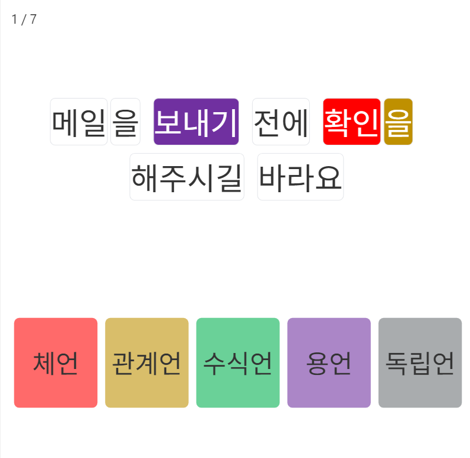

# 단어의 기능 구분

## 개요

단어의 기능 구분은 문장에서 단어들이 어떤 역할을 하는지 이해하는 훈련입니다. 각 단어의 기능을 정확히 파악하면 문법 구조를 이해하고 읽기 이해력을 높일 수 있습니다.

## 단어의 5가지 기능

### 1. 체언 (體言)
**역할**: 명사, 대명사, 수사로 이루어진 단어군
**특징**: 문장의 주요 대상이나 개념을 나타냄
**예시**: 사과, 그것, 셋

### 2. 용언 (用言)
**역할**: 동사, 형용사로 이루어진 단어군
**특징**: 동작이나 상태, 성질을 나타냄
**예시**: 먹다, 크다, 아름답다

### 3. 수식언 (修飾言)
**역할**: 다른 단어를 수식하는 단어군
**특징**: 관형사와 부사로 구성되며 수식 기능을 함
**예시**: 새로운, 빨리, 아주

### 4. 관계언 (關係言)
**역할**: 조사로만 이루어진 단어군
**특징**: 다른 단어들 간의 문법적 관계를 나타냄
**예시**: 이, 을, 에서, 와

### 5. 독립언 (獨立言)
**역할**: 감탄사로 이루어진 단어군
**특징**: 독립적으로 존재하며 다른 말과 문법적 연결 없음
**예시**: 아, 오, 어라, 헉

## 훈련의 효과

- 문장 구조의 이해 능력 향상
- 읽기 과정에서 단어의 역할 파악 능력 개발
- 문법적 분석 능력 강화

<figure><figcaption></figcaption></figure>
