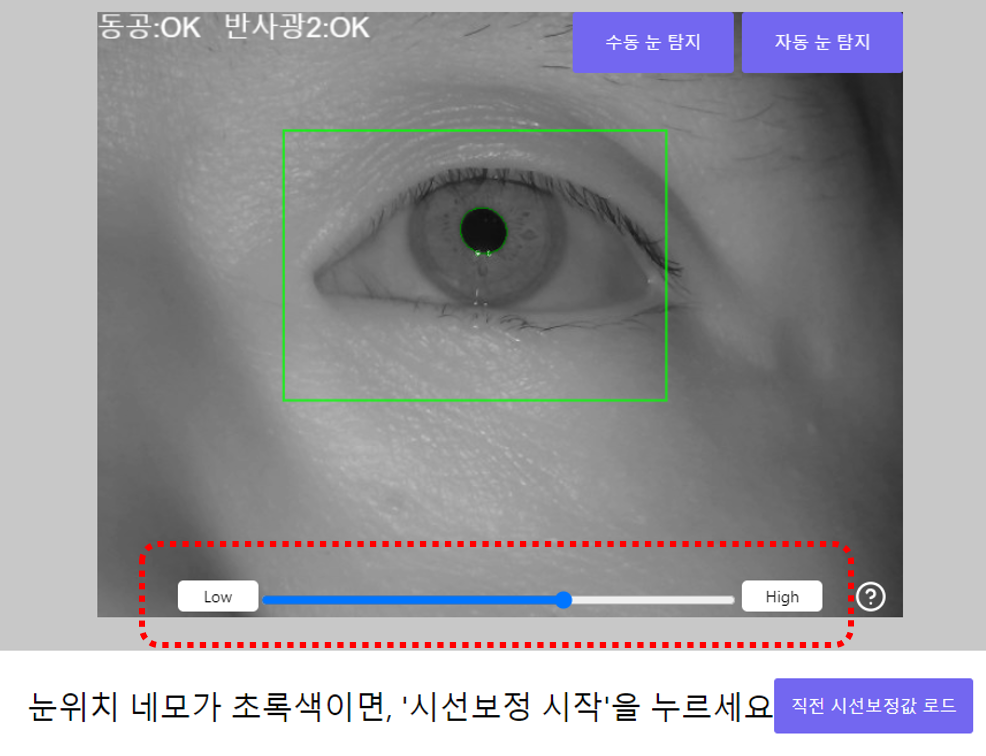

# 시선보정 (ver. 1)


시선보정은 운영자의 연습이 필요합니다. 수차례 연습하여 숙달되어야 정확한 진단이 가능합니다.


## 눈 영상 맞추기&#x20;

시선보정하기 를 선택하면, 다음과 같은 화면이 나타납니다.&#x20;

사용자가 편안하게 턱을 턱받침에 대고 모니터를 볼 수 있는 자세로 앉게 하십시오. 의자와 책상, 턱받침의 높이를 조정하여 편안하고 안정된 자세를 확보해야 합니다. 사용자가 마우스를 편하게 사용할 수 있도록 하십시오.

.png>)


만약 눈 영상이 나타나지 않는다면, 시선추적 카메라가 잘 연결되지 않은 것입니다. [FAQ](../../information/faq.md#undefined-4) 를 참고하십시오.



시선추적 카메는 사용자의 주시(dominant eye : 주로 사용하는 눈)을 측정합니다. 일반적인 사람은 오른쪽 눈이 주시입니다. 왼쪽 눈이 주시인 사람은 왼쪽 눈을 측정하도록 각도를 조정하십시오.


### 영상 위치 맞추기&#x20;

화면에 얼굴의 영상이 나타날 것입니다. 사용자의 오른쪽 눈이 화면 중앙에 위치하도록  시선추적 카메의 각도를 조정하십시오.&#x20;


가급적 안경 없이 진행하는 것이 좋습니다. 만약 안경의 반사광으로 인해 눈동자가 잘 탐지되지 않는다면, 안경을 잘 닦거나 안경의 위치를 조정해 보십시오.



사용자의 얼굴 크를 고려하여, 이마 밴드의 위치를 조절하십시오. 이마 밴드가 사용자들의 이마에 닿을 수 있는 위치가 적당합니다. (이마밴드를 꼭 써야 하는 것은 아닙니다.)


### 눈 영상 촛점 맞추기&#x20;

영상의 촛점이 잘 맞아야 정확한 측정이 됩니다. 촛점이 잘 안맞는 경우, 시선추적장치의 오른쪽 렌즈를 살짝 돌려서 촛점을 조정할 수 있습니다.&#x20;

.png>)

.png>)


Glint(흰 반사광 점)이 작게 보이는 것이 촛점이 잘 맞는 것입니다.&#x20;



렌즈를 너무 많이 돌리면 빠질 수 있습니다. 이 경우, 다시 끼워 주시기 바랍니다.


### 눈 영역 Eye Area 설정하기&#x20;

빨간 네모 영역이 눈의 위치와 잘 맞지 않으면, Eye Area 버튼을 눌러 재설정 하십시오.


마스카라 등 눈화장이 진하거나, 눈이 지나치게 작으면  탐지가 어려울 수 있습니다.


.png>)

.png>)

###

## 동공 감도 조절하기

동공(눈동자)를 탐지할 때, 눈동자 테두리에 정확히 초록색 원이 표시되지 않고 더 크거나 작게 탐지되는 경우가 있습니다. 이는 속눈썹이 가리거나, 홍채의 색이 진할 때 발생할 수 있습니다.

이런 경우, 영상 하단의 감도 슬라이더를 좌우로 조절하면 동공을 더 엄격하게 또는 관대하게 탐지할 수 있습니다.&#x20;


눈 크기가 작은 어린아이들의 경우엔 감도 조절이 대체로 필요합니다.


## 캘리브레이션 수행&#x20;

최대한 머리를 움직이지 말고, 눈만 움직여서 화면에 제시되는 점을 바라보십시오. 제대로 쳐다보면, 2초 이내에 빨간색 타겟 점 크기가 작아지며 다음 위치로 움직입니다. 캘리브레이션이 잘 되지 않으면 중단되며, 눈 영상위치를 재조정 하고 다시 시도하십시오.

.png>)


학생이 빨간 점 외에 다른 곳을 쳐다보면 제대로 보정이 되지 않습니다.


## 결과의 판단&#x20;

캘리브레이션을 수행하고 나면, 아래와 같은 화면이 보여집니다. 각 점을 쳐다보게 하면서 시선이 각 원 안에 들어가는지 확인하십시오. 만약 시선이 많이 어긋난다고 판단되면 캘리브레이션을 다시 수행하십시오.

.png>)


캘리브레이션이 진행된 이후부터는 진단이 다 끝날 때까지 머리를 움직이지 않도록 하십시오. 미세하게 흔들리는 정도는 괜찮으나, 많이 움직였다면 중단하고 처음부터  다시 하는 것이 좋습니다.


### 영상문제 보고하기  

거리, 촛점 등을 조정해도 개인의 눈 모양, 컨택트 렌즈 특성, 눈의 색상 의해 눈동자가 탐지되기 어려운 경우도 있습니다. 이런 경우에는 진단이 불가능합니다.&#x20;

그렇더라도, 향후 개선을 위하여 우측 상단의 \[영상문제보고 ]  버튼을 눌러 보고해 주시기 바랍니다.

.png>)

.png>)

영상녹화시작,을 누르고 화면에 제시되는 점을 보면 눈 영상이 보고됩니다. 리더스아이에서 보내주신 영상을 보고 검토할 수 있습니다.


보고된 눈 영상은 더 나은 품질을 제공하기 위하여 활용됩니다.

