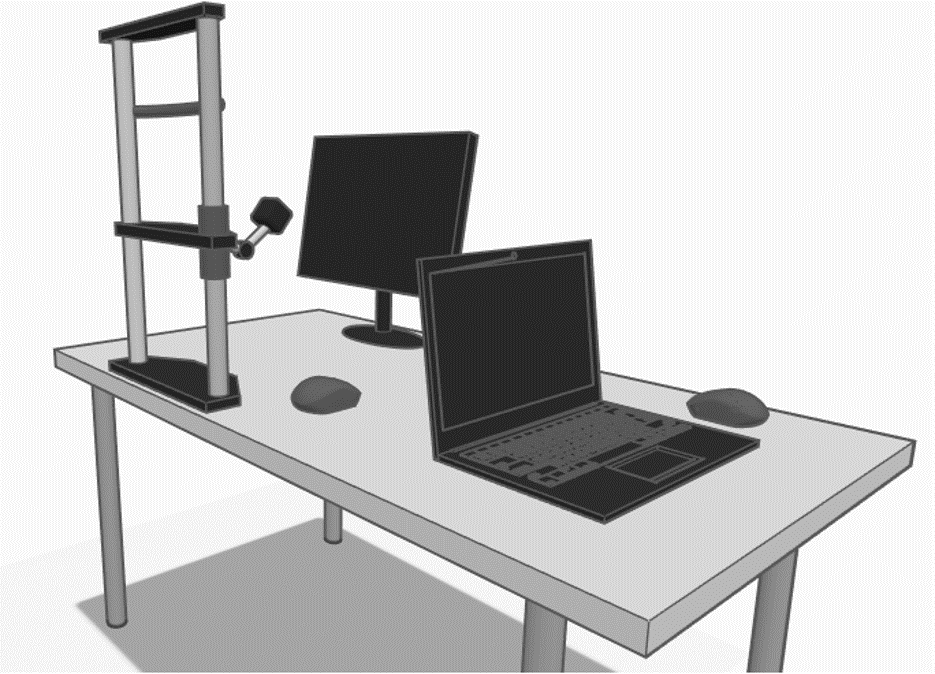
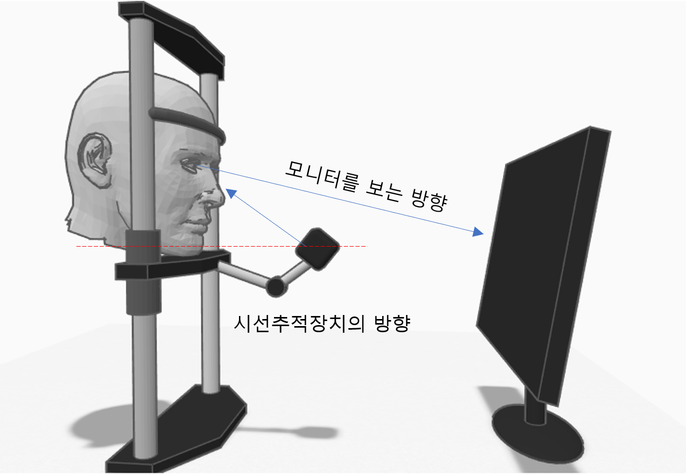
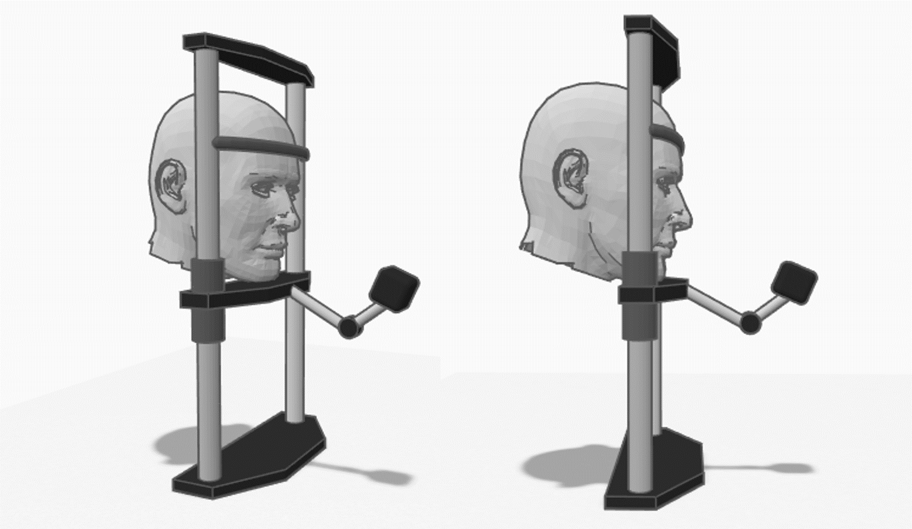

# 장비 설치하기 (Ver. 1)

## 컴퓨터와 장비의 배치&#x20;

진단을 위해서는 컴퓨터와 모니터, 진단장비가 있어야 합니다. 교사용 모니터와 진단용 모니터가 구분되는 것이 바람직하며, 주로 다음과 같은 형태로 구성할 수 있습니다.


모든 경우에 컴퓨터는 인터넷이 연결되어 있어야 합니다.


### 데스크탑 PC에 두 대의 모니터 설치

.png>)

* PC에 모니터를 2 대 연결하십시오.&#x20;
* 주 모니터는 교사가 보고, 학생은 확장 모니터(모니터2)를 봅니다.
* &#x20;웹서비스는 교사만 보고, 진단 시작 후 진단창만 모니터 2에 띄웁니다.
* &#x20;학생이 마우스로 응답할 수 있도록 별도의 마우스를 제공합니다.

### 노트북 1대와 확장 모니터

.png>)

* 노트북에 확장 모니터를 연결하십시오.&#x20;
* 노트북은 교사가 보고, 학생은 확장 모니터를 봅니다.
* 웹서비스는 교사만 보고, 진단 시작 후 진단창만 모니터 2에 띄웁니다.&#x20;
* 학생이 마우스로 응답할 수 있도록 별도의 마우스를 제공합니다.

### 데스크탑 PC 한 대와 모니터 한 대

.png>)

* PC에 모니터와 장비를 연결하십시오.&#x20;
* 교사와 학생이 같은 화면을 봅니다.&#x20;
* 교사가 웹서비스를 조작하고, 진단이 시작되면 학생이 진단을 수행합니다.
* &#x20;학생이 마우스로 응답할 수 있도록 별도의 마우스를 제공합니다.

## 시선추적 장비 설치하기&#x20;

1. 측정에 활용할 컴퓨터가 설치된 책상에, 장비를 설치하십시오.
2. 장비 앞에 모니터를 배치하십시오. (장비와 모니터의 거리가 60cm 정도입니다.)
3. 운영자가 사용할 컴퓨터와, 학생이 보는 모니터를 분리하는 것이 편리합니다.
4. 학생이 마우스를 사용할 수 있도록 준비하십시오. (2개의 마우스를 컴퓨터에 연결합니다.)


평가자(교사)와 사용자(학생)는 가급적 다른 화면을 보는 것이 좋으므로, 2개의 모니터를 사용하는 것을 권장합니다.&#x20;



어린 학생들을 위하여, 높이가 조절되는 책상 또는 의자를 사용하는 것이 좋습니다.&#x20;



진단을 하는 동안 움직이지 않는 것이 필요하므로, 가급적 바퀴가 없는 의자를 권장합니다.



직사광선이 들지 않는 실내가 좋습니다.


### 클램프로 고정하기&#x20;

.png>)


장비는 스스로 서 있을 수 있지만, 안정적으로 사용하기 위해서는 동봉된 클램프를 이용하여 책상에 고정하거나, 나사 등으로 완전히 고정시킬 수 있습니다.


## 턱받침과 모니터 설치하기&#x20;

턱받침을 책상 앞쪽에 배치하고, 모니터는 충분한 거리 (60\~70cm)를 두고 배치합니다.


모니터는 수직으로 볼 수 있도록 각도를 조정합니다.



필요시 턱받침에 1회용 위생 커버 종이를 사용하실 수 있습니다.


## 시선 추적 카메라 각도 조정하기&#x20;

1. 턱받침에 턱을 밀착시켰을 때, 편하게 모니터를 바라볼 수 있도록 턱받침의 높이를 조절하세요.&#x20;
2. 약간 아래를 바라보는 자세로 하는 것이 좋습니다.


머리 밴드의 높이는 나사를 풀어 조정할 수 있습니다. 머리 밴드는 이마에 닿도록 합니다. 머리를 움직이지 않을 수 있다면  머리 밴드는 꼭 필요하지는 않습니다. (이마 밴드는 제공되지 않을 수 있습니다.)



시선추적 카메의 높이는 높을 수록 좋습니다. 시야(화면)이 가려지지 않는 한에서, 암을 움직여서 대한 위쪽으로 조절해 주십시오. 최소한 턱 높이 이상이 좋습니다. (위의 빨간 점선 참조)&#x20;


## 시선추적 카메라를 컴퓨터에 연결하기

1. 시선추적 카메의 USB커넥터를를 컴퓨터의 USB 포트에 연결합니다.&#x20;
2. 컴퓨터에서 '새로운 디바이스를 찾았습니다. 설치 중...' 과 같은 메시지가 뜰 것입니다.
3. 잠시 뒤, '이제 사용할 수 있습니다' 라는 메시지가 뜰 것입니다.


이 메시지는 최초 1회만 나타납니다. USB포트를 바꿔 연결하면 다시 나타날 수 있습니다.

